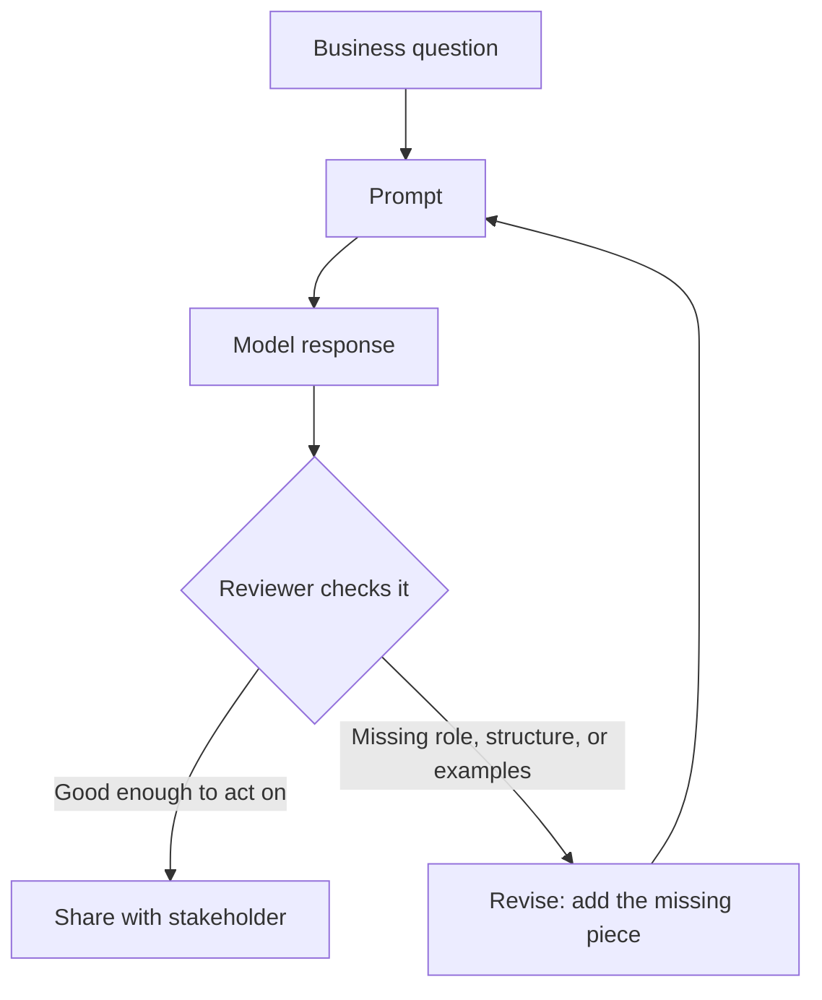

# S00 Learner Handout — Prompt Engineering Foundations

**AI-Focused Forward Deployed Engineering · Session 00 · 90 minutes**
**Case study:** Northstar (fictional) · Earning the next meeting before writing any code

Before Northstar ever had the support-ticket system you build in S01 and S02, it was an
unproven engagement. Leadership asked for two things in one week: a believable explanation
of why customers were churning, and a read on what their written feedback was actually
about. There was no budget yet for a custom pipeline, no signed data-processing agreement
for a production integration — just two CSV exports and a deadline. The deliverable had to
come from a prompt, not a build.

## 🎯 What you will learn

By the end of this session, you should be able to: treat a prompt as a specification
rather than a search box; name and apply six reusable prompt patterns; predict the specific
failure a given pattern fixes; use a naive-vs-patterned comparison to argue for a pattern
with evidence instead of taste; and recognize the point where a prompt-only workflow stops
being enough and a verified build (S01) or a typed contract (S02) takes over.

## 1. 🧩 A prompt is a specification, not a question

Experienced engineers already know this move from everywhere else in software: an
under-specified request produces an implementation that technically answers the question
and still isn't useful. "Suggest charts for tracking engagement" is under-specified in
exactly the way a ticket that just says "fix the dashboard" is. A prompt pattern is a
template for closing a specific class of under-specification — not a trick, and not
"magic words."

**Engineering decision:** Start with the plainest prompt that could work. Add a pattern
only to fix an observed failure (wrong audience, wrong depth, inconsistent format, missed
negation) — not by default, and not all six at once.

## 2. 🧩 Six patterns, one job each

| Pattern | What it adds to the prompt | Fixes |
|---|---|---|
| **Persona** | A role, expertise level, and implicit audience | Generic, context-free answers |
| **Chain-of-Thought (CoT)** | An instruction to reason step-by-step before concluding | Jumping to a conclusion without showing the trade-off |
| **Question Refinement** | An instruction for the model to clarify before answering | A vague goal with no stated success criteria |
| **Few-Shot** | 2–3 worked input→output examples | Inconsistent labels/format across similar inputs |
| **Flipped Interaction** | An instruction for the model to ask *you* questions, one at a time | Passive consumption when the goal is to test your own understanding |
| **Semantic Filter + Recipe** | A target theme set + a request for insight per theme | Unstructured text that needs to become decision-ready categories |

## 3. 🧩 Pattern walkthroughs

### 3.1 Persona Pattern

> **BEFORE:** Suggest the right charts for tracking customer engagement metrics.
>
> **AFTER:** You are a senior BI consultant with 10+ years of dashboard design experience.
> Suggest the charts you'd use to track customer engagement metrics, and flag any chart
> choice here that would mislead a non-technical stakeholder.

**Why it works:** assigning a role narrows the implicit audience and the quality bar the
model holds itself to — it stops answering "what charts exist" and starts answering "what
would I actually ship to a stakeholder."

> [!TIP]
> **📎 Reminder:** a persona changes the *frame*, not the facts. It won't make a wrong chart
> choice correct — pair it with a reviewer who can catch a confident, wrong answer.

### 3.2 Chain-of-Thought (CoT)

> **BEFORE:** Why did our CSAT score drop?
>
> **AFTER:** Northstar's support team saw CSAT drop from 92% to 81%, average first-response
> time rise from 4 hours to 11 hours, and ticket volume increase 30% in the same month.
> Think step-by-step about what could be driving the CSAT drop, and state which single
> metric you'd investigate first and why.

**Why it works:** forcing a stated reasoning path surfaces *which* correlated signal the
model is actually weighting, so a reviewer can agree or push back on the reasoning — not
just the headline conclusion.

### 3.3 Question Refinement

> **BEFORE:** Help me reduce churn.
>
> **AFTER:** I want to reduce churn, but "reduce churn" is too vague to act on yet. Before
> answering, ask me 3–5 clarifying questions about what's actually driving it for us, then
> help me turn this into specific, measurable questions I can answer from our data.

**Why it works:** you begin vague on purpose and let the model drive you toward precision,
instead of silently guessing your intent and answering the wrong question confidently.

### 3.4 Few-Shot Prompting

> Classify each comment as Positive, Neutral, or Negative:
>
> "Fantastic purchase, will buy again!" → Positive
> "Product is okay, nothing special." → Neutral
> "Customer service was unhelpful." → Negative
>
> Now classify:
> "Not bad, but could be better." →
> "Would not recommend to anyone." →
> "Neither good nor bad." →

**Why it works:** the examples pin down the *boundary* cases — negation ("would not
recommend"), hedging ("not bad, but..."), and cancellation ("neither good nor bad") — that
a label name alone leaves ambiguous. The lab makes this concrete: a naive, keyword-only
classifier and a few-shot-informed one are run against the same labeled comments so you can
see exactly which comments each one gets wrong, not just a headline accuracy number.

### 3.5 Flipped Interaction

> I want to test my understanding of churn-analysis metrics. Ask me 5 multiple-choice
> questions, one at a time. Wait for my answer before giving the next question. After each,
> tell me if I'm right and briefly explain.

**Why it works:** this turns the model into a quiz master instead of a source you passively
read — useful for your own self-study, and for onboarding a teammate without writing a
training deck.

### 3.6 Semantic Filter + Recipe Pattern

> Here is a batch of Northstar customer feedback:
>
> 1. "Customer service was unhelpful."
> 2. "Shipping took forever."
> 3. "Poor quality and overpriced."
> 4. "Packaging was damaged upon arrival."
>
> Categorize these into themes: **Delivery, Pricing, Product Quality, Customer Support.**
> Then give one short insight per theme.

**Why it works:** this is a *recipe* (a reusable, repeatable process) applied through a
*semantic filter* (grouping by meaning, not keyword matching — "took forever" and "damaged
upon arrival" are both Delivery even though neither says the word "delivery"). This is the
same shape of task as Northstar's actual ask: turn 100 loose comments into something a
support lead can act on this week.

## 4. 🧩 Patterns compose — Meta Prompt + Role + Structure

The patterns above aren't mutually exclusive — a real deliverable usually stacks two or
three:

> Act as a data storytelling expert. I have Northstar's quarterly churn numbers to present
> to senior leadership. Convert these data points into a short narrative with three
> sections: **Context, Key Insight, Call-to-Action.**
>
> Data points:
> - Overall churn rate is 20.4%
> - Germany's churn rate is roughly double France's and Spain's
> - Customers with only 1 product churn far more than customers with 2 products (27.7% vs.
>   7.6%) — two smaller groups (3 or 4 products, under 350 customers combined) show even
>   higher churn, but are too small to generalize from without checking first

This combines **Persona** (data storytelling expert), **Recipe** (a named 3-part template),
and an implicit **Meta Language** instruction (the section names *are* the format
contract). It's also exactly the kind of prompt you'd paste into a prompt-driven analytics
tool like Julius.ai once you already have the numbers — the lab's churn exercise gets you
to the numbers; this is how you'd turn them into something a VP reads in thirty seconds.

> [!NOTE]
> Six more named patterns exist beyond today's six — **Template, Fact Checklist, Meta
> Language, Audience Persona, Menu Actions, Tail Generation** — worth knowing by name if you
> encounter them, but not covered in depth in this session.

## 5. 🛠️ Why this matters for FDE work — and where it stops

A well-patterned prompt is the fastest way to produce a convincing, reviewable artifact
before an engagement has earned the budget for a real build. That's a genuine FDE skill:
most customers decide whether to fund the pipeline *based on* a result like this one.

> [!IMPORTANT]
> A convincing output is not a verified one. The moment a prompt's output starts driving an
> unreviewed business decision — refunding a customer, prioritizing an engineering backlog,
> telling a VP a number is real — you've silently crossed from "prototype" into "production
> decision," without building any of the verification S01 requires or the typed contract
> S02 requires. Notice that crossing; don't let it happen by accident.

## 🛠️ Forward Deployed Engineer Decision Challenge

**Customer scenario:** Northstar leadership needs a believable churn/feedback read
before authorizing a larger engagement — one week, two CSVs, no budget yet.

**Engineering decision:** Which prompt pattern(s) actually fit this ask, and where does
this prompt-only workflow stop being trustworthy enough to act on without further work?

**Your deliverable:** A one-page pre-engagement readout memo — headline finding,
evidence, one honest caveat, one concrete next step. ~10–15 minutes.

**Full exercise, rubric, and worked examples:**
[`docs/fde-exercises/prompt-engineering-decision.md`](../../docs/fde-exercises/prompt-engineering-decision.md)

## ✅ Check your understanding

1. Which single pattern would you reach for first if a model's answers to the same kind of
   question keep coming back in inconsistent formats?
2. Why does the few-shot example set in 3.4 deliberately include a negated sentence
   ("would not recommend") instead of only clear positive/negative examples?
3. What does the Semantic Filter pattern group by, if not keywords?
4. A stakeholder says "just ask it to explain its reasoning, that's Chain-of-Thought."
   What's missing from that claim?
5. Give one concrete signal that would tell you a prompt-only workflow has stopped being
   enough for a given decision.

> [!TIP]
> **Expected takeaways:** reach for Few-Shot to fix inconsistent formatting; the negated
> example exists because a label name alone doesn't disambiguate negation — the model needs
> to see a worked case; Semantic Filter groups by meaning, not surface keywords; a stated
> instruction to "think step by step" is necessary but not sufficient for CoT — the prompt
> should also give the model something concrete to reason *over* (stated metrics, stated
> trade-offs); the business-decision crossing described in §5 is the signal.

## 📚 Further reading

- [promptingguide.ai](https://www.promptingguide.ai/) — a maintained reference for prompt
  patterns and technique names beyond today's six.
- [Julius.ai](https://julius.ai/) — a prompt-driven data-analysis tool; the lab's churn
  exercise is written so the same prompt you draft there is the one you'd paste into a tool
  like this.

## 🗺️ What you have built, and what's next

**What you have built:** six reusable prompt patterns, a naive-vs-few-shot comparison
with real evidence of *which* comments each approach gets wrong, and a real,
data-grounded churn/feedback readout — all without writing a line of application code.

**What limitations remain:** no independent verification, no typed output contract, and
no repeatable automation. This is a one-off, human-reviewed read, not a production
decision system — and nothing here should run unattended on live customer data.

**What the next session adds:** **S01: Verified Agent Loops** adds independent
verification and a bounded agent loop, for when a task needs tool access and a stop
condition. **S02: Structured Outputs and Model Selection** adds a typed contract and a
model-comparison method, for when an output needs to drive an automated decision. Either
can come next — neither depends on this session or on each other.

---

## About the mentor

**Sanjay Negi** brings 23+ years of industry experience and helps experienced software engineers and technology leaders transition into high-value AI roles, including **AI Engineer**, **Forward Deployed Engineer**, and **GenAI Architect**. He has trained more than 1,100 experienced engineers.

<strong>#SkillUpWithSanjay</strong>

<a href="https://www.sanjaynegi.in" target="_blank" rel="noopener noreferrer">Website</a>&nbsp;&middot;&nbsp;<a href="https://www.linkedin.com/in/sanjay-negi-ai/" target="_blank" rel="noopener noreferrer">LinkedIn</a>

