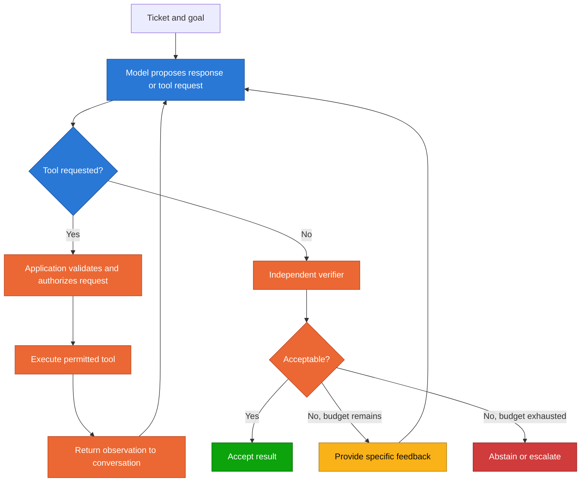

# S01 Learner Handout — From LLM Calls to Verified Agent Loops

**AI-Focused Forward Deployed Engineering · Session 01 of 7 · 90 minutes**  
**Case study:** Northstar Support Systems (fictional) · Support-ticket triage

Northstar's tickets already get answered by a model. This session answers a harder
question: who's allowed to act on that answer, when does the system get to try again, and
when does it have to stop and ask a human instead?

## 🎯 What you will learn

By the end of this session, you should be able to run a Python AI project with `uv`, distinguish a model's tool request from actual tool execution, trace a bounded agent loop, identify the harness's responsibilities, verify an output independently of the model's claims, and decide when *not* to use an agent.

## 1. 🧩 Start with the business problem

Northstar receives tickets that should be routed to **billing**, **technical**, **account**, or **general** support. Some tickets contain enough information to classify directly; others require a permitted lookup of synthetic account context.

**Engineering decision:** Start with the simplest workable approach. Rules may be enough for predictable inputs; a single model call may handle ambiguous text; a tool-using loop is justified only when the task needs additional information or actions. An agent is not automatically better.

Example *candidate* result (not yet verified):

```json
{"ticket_id":"T-104","category":"billing","priority":"normal","requires_human_review":false}
```

## 2. 🧩 Five essential concepts

| Concept | Meaning | Engineering question |
|---|---|---|
| **Model call** | Send context/instructions to a model and receive a response | What did the model propose? |
| **Agent loop** | Repeatedly request decisions, execute authorized tools, incorporate observations, and stop | What happens next, and when do we stop? |
| **Harness Engineering** | Design the software surrounding model execution: tools, state, permissions, limits, logging, and recovery | What can the agent safely do? |
| **Verification** | Independently check a proposed result against explicit criteria | Is the result acceptable? |
| **Loop Engineering** | Our course's teaching term for deliberately designing feedback, continuation, retries, stopping, and iterative improvement | How does the process react and improve? |

*Loop Engineering* is a course-defined perspective, not a universally standardized software component. It connects the agent loop, harness, and verification policy.

### The core control flow



> [!IMPORTANT]
> The model can *request* a tool call; the application must authorize and execute it. A
> tool schema is not a security boundary. Actual SDK implementations also need to preserve
> tool-call identifiers and associate each result with the corresponding request.

## 3. 💻 Work in VS Code with uv

The course's pre-course onboarding covers installation. In the starter project, use:

| Command | What it does |
|---|---|
| `uv --version` | Confirm uv is available |
| `uv init northstar-triage` | Initialize a new project (when starting from scratch) |
| `uv python pin 3.12` | Select a project Python version |
| `uv add openai python-dotenv` | Add dependencies when needed |
| `uv add --dev pytest` | Add pytest as a development dependency |
| `uv sync` | Synchronize environment from project metadata/lockfile |
| `uv run python main.py --mode mock` | Run the **planned starter-lab interface** using the managed environment |
| `uv run pytest` | Execute tests once provided |
| `uv tree` | Inspect dependency relationships |

**Project files:** `pyproject.toml` declares dependencies; `uv.lock` records resolved versions; `.venv/` is the local environment. Commit the lockfile for a reproducible application; do not commit `.venv/` or `.env` secrets. The `--mode mock` argument is part of our **planned lab application**, not a built-in uv option. A mock response is simulated, not a real model call.

## 4. 💻 Build a bounded agent loop

A conceptual sketch (not a drop-in SDK implementation):

```python
for step in range(max_steps):
    decision = model_call(conversation, available_tools)

    if decision.requests_tool:
        request = validate_and_authorize(decision.tool_request)
        observation = execute_tool(request)
        conversation = append_tool_exchange(conversation, decision, observation)
        continue

    errors = verify(decision.candidate, ticket_id)
    if not errors:
        return decision.candidate

    conversation = append_feedback(conversation, errors)

return {"status": "needs_review", "reason": "step budget exhausted"}
```

A production implementation also needs malformed-argument handling, tool timeouts, repeated-call detection, retry budgets, exception paths, and appropriately redacted telemetry. A maximum-step limit prevents unbounded looping; it does **not** guarantee correctness.

## 5. 🧩 Verify, then decide what happens next

Consider this invalid model output:

```json
{"ticket_id":"T-104","category":"refunds","priority":"normal"}
```

It violates two clear constraints: `refunds` is not an allowed category, and `requires_human_review` is missing.

```python
def verify(candidate: dict, expected_ticket_id: str) -> list[str]:
    errors = []
    if candidate.get("ticket_id") != expected_ticket_id:
        errors.append("ticket_id mismatch")
    if candidate.get("category") not in {"billing", "technical", "account", "general"}:
        errors.append("invalid category")
    if not isinstance(candidate.get("requires_human_review"), bool):
        errors.append("missing/invalid review flag")
    return errors
```

These checks verify **structure and explicit invariants**, not whether the category is semantically correct. For semantic quality, use reference-labeled tickets, evidence checks, representative evaluations, and human review when appropriate. Model-stated confidence is not independent evidence.

**Event-driven continuation:** A tool result arriving or a verifier returning a specific failure is an event that can justify the next step. This does not require a distributed event bus.

**Introductory hill-climbing:** Measure a baseline against a defined test set; make one targeted change (for example, improve the classification instructions); measure again; keep the change only if it improves the chosen objective without violating constraints. Beware noisy small samples and optimizing a metric that does not reflect customer outcomes.

## 6. 🔍 Security and failure modes

| Failure | Appropriate response |
|---|---|
| Model asks to look up another customer's account | Deny at tool authorization; do not rely on final-output verification |
| Model returns an out-of-enum category | Reject and return specific feedback within a retry budget |
| Model repeatedly calls the same tool | Detect repetition; stop or escalate |
| Tool fails or times out | Record controlled error; retry only when safe and bounded |
| Result passes JSON/schema checks but is factually wrong | Evaluate against evidence or reference labels; consider human review |
| API or model tool support unavailable in class | Use a clearly labeled deterministic mock path |

> [!CAUTION]
> Use **synthetic data only** for exercises. Never commit API keys or display real secrets.
> Provider privacy settings, pricing, and tool compatibility must be checked before using a
> live endpoint.

## 7. 🛠️ Hands-on challenge

Inspect this trace:

```text
1. Ticket T-104 arrives for account A-104.
2. Model requests lookup for account A-999.
3. Tool returns account A-999 details.
4. Model proposes category = "refunds".
5. Application accepts the result.
```

**Your task:** Identify (a) the authorization failure, (b) the verification failure, (c) the safe next action, and (d) one test that would catch each problem. Explain why correcting the final category would **not** undo an earlier unauthorized disclosure.

### ✅ Quick knowledge check

1. Does a model-generated tool call mean the tool has executed?
2. Can valid JSON still be wrong?
3. What stops a failed agent from retrying forever?
4. When might a single LLM call be preferable to an agent loop?
5. How does a verifier differ from the model evaluating its own answer?

> [!TIP]
> **Expected takeaways:** The model proposes; application code authorizes and acts;
> verification checks explicit criteria; bounded feedback determines whether to accept,
> retry, abstain, or escalate.

## 📚 Further reading

- [uv: Projects](https://docs.astral.sh/uv/guides/projects/) — environments, dependencies, and lockfiles.
- [uv: CLI reference](https://docs.astral.sh/uv/reference/cli/) — command details.
- [OpenAI: Function calling](https://platform.openai.com/docs/guides/function-calling) — tool request and execution concepts.
- [OWASP: LLM application security](https://genai.owasp.org/) — prompt injection and tool-use risks.

---

## About the mentor

**Sanjay Negi** brings 23+ years of industry experience and helps experienced software engineers and technology leaders transition into high-value AI roles, including **AI Engineer**, **Forward Deployed Engineer**, and **GenAI Architect**. He has trained more than 1,100 experienced engineers.

<p align="center"></p>

<p align="center"><strong>#SkillUpWithSanjay</strong></p>

<p align="center"><a href="https://www.sanjaynegi.in" target="_blank" rel="noopener noreferrer">Website</a>&nbsp;&middot;&nbsp;<a href="https://www.linkedin.com/in/sanjay-negi-ai/" target="_blank" rel="noopener noreferrer">LinkedIn</a></p>
