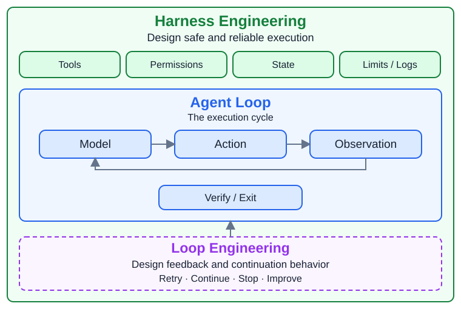
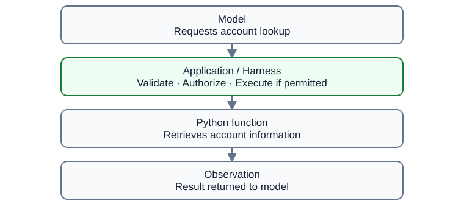
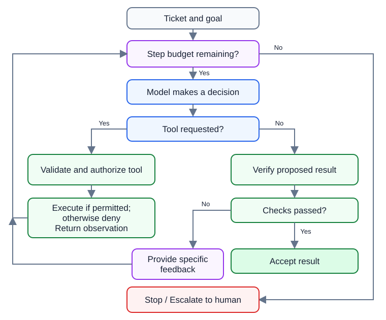
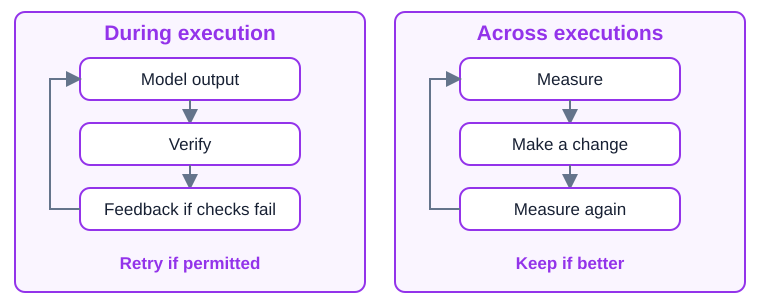

# S01 — From LLM Calls to Verified Agent Loops

**AI-Focused Forward Deployed Engineering | Session 01 | 90 minutes**

**Case study:** Northstar Support Systems (fictional) — Support-ticket triage

## 🎯 What you will learn

- Understand when to use a model call versus an agent.
- Distinguish Agent Loop, Harness Engineering and Loop Engineering.
- Understand how models request tools and applications execute them.
- Build a bounded agent loop and verify its outputs.
- Handle failures, retries and human escalation.
- Run a Python AI project using `uv`.

## 1. Start with the business problem

Northstar receives support tickets that need to be routed to billing, technical, access or general support. Some tickets are easy to classify. Others require additional account information.

Which approach would you choose?

| Approach | When to use it |
|---|---|
| Rules | Conditions are predictable. |
| Single LLM call | Understanding the ticket requires interpreting natural language. |
| Agent loop | Additional information or actions are needed before reaching a decision. |

**Engineering principle:** Start with the simplest solution that works. Not every AI application needs an agent.

A proposed ticket classification:

```json
{"ticket_id":"T-104","category":"billing","priority":"medium","needs_human":false}
```

The model has proposed a result. But should the application trust it?

## 2. Understanding the core concepts

### Model Call

Send instructions and information to an AI model and receive a response.

**Think of it as:** An API request-response interaction, except the generated answer is not necessarily correct.

In Northstar, we send a ticket to the model and ask it to suggest a category.

### Agent Loop, Harness Engineering and Loop Engineering

These three concepts are closely related, but they are not the same.



*Three perspectives of the same AI system, not three separate software components.*

### 🔵 Agent Loop — The execution mechanism

A cycle in which the model makes a decision, the application performs an authorized action if needed, and the model receives the result to decide what happens next.

**Think of it as:** A software workflow that repeats until it reaches a stopping condition.

In Northstar:

- The model reads a ticket and requests account information.
- The application retrieves the permitted information.
- The model uses it to make its next decision.

**Focus: How the agent executes.**

### 🟢 Harness Engineering — Making execution reliable

Building the software around the model and its execution loop. The harness manages:

- Tools and their execution.
- Permissions and authorization.
- Conversation state.
- Execution limits, error handling and logging.

**Think of it as:** The application runtime and control infrastructure surrounding the model.

In Northstar, the harness prevents unauthorized access to another customer's account details.

**Focus: How we make execution safe, controlled and reliable.**

### 🟣 Loop Engineering — Designing execution behavior

Designing how the execution loop responds to feedback:

- When to continue or retry.
- What feedback to provide.
- When to stop or escalate.
- How to improve the workflow over time.

**Think of it as:** Designing the feedback and retry policies of a software workflow.

In Northstar, if the model returns an invalid category, we decide whether to provide corrective feedback, retry or escalate.

**Focus: How we design feedback, continuation and improvement.**

*Loop Engineering is a teaching term used in this course, not a universally standardized engineering discipline.*

### Remember the difference

| | Agent Loop | Harness Engineering | Loop Engineering |
|---|---|---|---|
| Primary focus | Execution | Control | Feedback and behavior |
| Key question | What happens next? | Is it safe and permitted? | Should we continue, retry or stop? |
| Northstar example | Request account details | Authorize the request | Decide what to do after receiving the result |

The concepts intentionally overlap.

**Loop Engineering designs the retry policy; the harness implements and enforces it; the Agent Loop executes according to it.**

## 3. Tool Calling — How models interact with applications

A model cannot directly execute your Python functions. It requests that your application execute them.

For example, the model may request `lookup_account(account_id="A-104")`.



### Tool Registry and Dispatcher

| Concept | Meaning |
|---|---|
| Tool Registry | A collection of functions available to the model. |
| Dispatcher | Application code that validates, authorizes and executes requests. |
| Observation | The result returned after executing a tool. |

```python
tools = {"lookup_account": lookup_account}

def dispatch(name, args, state):
    if name not in tools:
        return {"error": "unknown tool"}
    if not isinstance(args, dict):
        return {"error": "invalid arguments"}
    if not authorized(name, args, state):
        return {"error": "not authorized"}
    try:
        return {"result": tools[name](**args)}
    except Exception as exc:
        return {"error": str(exc)}
```

This is a conceptual example with basic argument checking, not complete argument validation or production-ready error handling. A tool schema is not a security boundary.

**Harness Engineering:** We are building the mechanism that controls tool execution.

Real SDK implementations must also match each tool result to its tool-call ID.

**Key takeaway:** The model requests. The application authorizes and executes.

Optional companion notebook: `lab/Tool_Calling_From_Scratch.ipynb`

## 4. Building a bounded Agent Loop

When a single model call is not sufficient, the model can receive additional information and make another decision. But this process cannot continue indefinitely.



```python
for step in range(max_steps):
    decision = model_call(conversation, available_tools)

    if decision.requests_tool:
        request = validate_and_authorize(decision.tool_request)
        observation = execute_tool(request)
        conversation = append_tool_exchange(conversation, decision, observation)
        continue

    errors = verify(decision.candidate, ticket_id)
    if not errors:
        return decision.candidate

    conversation = append_feedback(conversation, errors)

return {"status": "needs_review", "reason": "step budget exhausted"}
```

This is conceptual code, not a complete SDK implementation. A denied request must never reach tool execution.

### Where do our three concepts appear?

| Code or behavior | Concept |
|---|---|
| Repeated model calls | Agent Loop |
| Tool authorization and execution | Harness Engineering |
| Managing conversation state | Harness Engineering |
| Designing the maximum-step policy | Loop Engineering |
| Enforcing the step limit | Harness Engineering |
| Designing corrective feedback and escalation | Loop Engineering |

Production code must also handle tool failures, timeouts, repeated requests, malformed arguments and safe logging.

**Key takeaway:** A bounded loop prevents endless execution. It does not guarantee correctness.

## 5. Verification — Can we trust the result?

Consider this proposed Northstar result:

```json
{"ticket_id":"T-104","category":"refunds","priority":"medium"}
```

Two problems:

- `refunds` is not an allowed category.
- The `needs_human` field is missing.

The application should reject it.

```python
def verify(candidate, expected_ticket_id):
    errors = []
    if candidate.get("ticket_id") != expected_ticket_id:
        errors.append("ticket_id mismatch")
    if candidate.get("category") not in {
        "billing", "technical", "access", "general"
    }:
        errors.append("invalid category")
    if not isinstance(candidate.get("needs_human"), bool):
        errors.append("missing/invalid review flag")
    return errors
```

This example checks selected requirements, not the complete output contract.

**Think of it as:** Acceptance tests for a model-generated result.

| Structural correctness | Semantic correctness |
|---|---|
| Is the output in the expected format? | Is the answer actually correct? |
| Are required fields present? | Is the ticket routed to the right team? |
| Are values allowed? | Does the evidence support the decision? |

An output can pass structural checks and still be wrong. Semantic quality requires reference-labeled tickets, evidence checks, evaluations or human review. Model-stated confidence is not independent evidence.

- **Harness Engineering:** Implements and runs verification.
- **Loop Engineering:** Designs what happens when verification succeeds or fails.
- **Agent Loop:** Executes the next step according to that decision.

## 6. Loop Engineering — Feedback and improvement

Loop Engineering operates at two levels in this course.



### Event-driven continuation

An event determines what the loop should do next.

| Event | Next action |
|---|---|
| Account details received | Ask the model to continue. |
| Verification failed | Provide feedback and retry if permitted. |
| Verification passed | Accept the result. |
| Step budget exhausted | Stop and escalate. |

**Think of it as:** An event handler. This does not require a distributed event bus.

### Hill-climbing — Improving over time

For Northstar:

1. Measure classification quality using a test set.
2. Make one targeted change to the model instructions.
3. Measure quality again.
4. Keep the change if results improve without violating constraints.

**Think of it as:** Performance tuning — measure, change, measure again.

Avoid drawing conclusions from very small test samples or optimizing metrics unrelated to customer outcomes.

## 7. Security and failure handling

The harness must enforce business and security rules independently of the model.

| Failure scenario | Appropriate response |
|---|---|
| Model requests another customer's details | Deny access before tool execution. |
| Model returns an invalid category | Reject and provide feedback within limits. |
| Model repeatedly requests the same tool | Detect repetition; stop or escalate. |
| Tool fails or times out | Retry only when safe and bounded. |
| Valid JSON contains an incorrect classification | Check evidence or request human review. |
| Model API is unavailable | Use a clearly labeled mock. |
| Model requests duplicate escalations | Prevent duplicate business actions. |
| Model requests an unauthorized escalation | Deny the action. |

### Read versus write operations

| Tool | Purpose | Operation |
|---|---|---|
| `lookup_account` | Retrieve account details | Read |
| `create_escalation` | Create an escalation | Write |

Creating an escalation changes the business system. The harness must ensure:

- The ticket is high priority.
- The customer has premium support.
- An escalation has not already been created for the ticket.

**Think of duplicate prevention as:** Business-level idempotency. Even if the model changes its reason, a second escalation for the same ticket must be blocked.

**Key takeaway:** Valid arguments do not mean an authorized business action.

Use synthetic data only. Never expose real customer details or API keys. Check provider privacy settings, pricing and tool compatibility before using a live endpoint.

## 8. Forward Deployed Engineer — Decision Challenge

Northstar wants AI to retrieve account information and route tickets, including billing disputes, with minimal engineering review. Security and Compliance has not approved which account data the workflow can access.

Design a short workflow authorization and escalation plan:

- Is an agent loop actually required?
- Which tools should be allowed or prohibited?
- What should the verifier check?
- When should the workflow retry or stop?
- When should a human intervene?

**Deliverable:** A one-page design. **Duration:** 10–15 minutes.

Complete this before the hands-on challenge.

Full exercise and rubric: [`docs/fde-exercises/verified-agent-loop-decision.md`](../../docs/fde-exercises/verified-agent-loop-decision.md)

## 9. Hands-on challenge

Review this execution trace:

```text
1. Ticket T-104 arrives for account A-104.
2. Model requests lookup for account A-999.
3. Tool returns account A-999 details.
4. Model proposes category = "refunds".
5. Application accepts the result.
```

Identify:

1. Where did the Agent Loop execute?
2. Where did Harness Engineering fail?
3. What should independent verification have rejected?
4. What should the Loop Engineering policy have decided?
5. Which tests would catch these failures?
6. Would correcting the final category undo the unauthorized disclosure?

## 10. Quick knowledge check

1. Does a model-generated tool request mean the tool has executed?
2. Can structurally valid JSON still be incorrect?
3. What prevents an agent from retrying forever?
4. When is a single model call preferable to an agent?
5. How is independent verification different from the model evaluating itself?
6. Who designs, enforces and executes the retry policy?

<details>
<summary>Reveal answers</summary>

1. No. The application must authorize and execute it.
2. Yes. Structural validity does not guarantee semantic correctness.
3. A bounded execution policy enforced by the harness.
4. When the task can be completed without additional information or actions.
5. It checks the result against independently defined requirements or evidence.
6. Loop Engineering designs it, the harness enforces it, and the Agent Loop executes according to it.

</details>

## 11. Lab reference — VS Code and uv

`uv` helps manage Python projects, dependencies and environments. Installation is covered in pre-course onboarding.

| Command | Purpose |
|---|---|
| `uv --version` | Check installation |
| `uv init northstar-triage` | Create a new project from scratch |
| `uv python pin 3.12` | Select Python version |
| `uv add openai python-dotenv` | Add dependencies |
| `uv add --dev pytest` | Add test dependency |
| `uv sync` | Synchronize environment |
| `uv run python main.py --mode mock` | Run the lab in mock mode |
| `uv run pytest` | Run tests |
| `uv tree` | View dependencies |

| Project file | Purpose |
|---|---|
| `pyproject.toml` | Project dependencies |
| `uv.lock` | Resolved dependency versions |
| `.venv/` | Local Python environment |
| `.env` | Environment variables and secrets |

Commit the lockfile. Do not commit `.venv/` or `.env` secrets.

The `--mode mock` option belongs to the course application, not `uv`. A mock model simulates responses without calling a real LLM.

## 12. Where these concepts appear in real frameworks

| Course terminology | LangChain / LangGraph |
|---|---|
| Tool Registry | Registered tools |
| Tool Request | `AIMessage.tool_calls` |
| Dispatcher | Tool invocation / `ToolNode` |
| Observation | `ToolMessage` |
| Request-result matching | `tool_call_id` |
| Business authorization | Application-defined policy and hooks |

Frameworks provide execution mechanisms. Your application must still define business authorization and safety policies.

Optional references: [LangChain tool calling](https://docs.langchain.com/oss/python/langchain/models) · [LangGraph ToolNode](https://reference.langchain.com/python/langgraph.prebuilt/tool_node/ToolNode) · [ToolNode source code](https://github.com/langchain-ai/langgraph/blob/main/libs/prebuilt/langgraph/prebuilt/tool_node.py)

## 13. Session recap

### What you have built in the lab

- A bounded Agent Loop (`triage/core.py`).
- A tool registry and dispatcher with read and write tools.
- Tool authorization and independent verification.
- Feedback and bounded retries.
- Repeated-call and duplicate-action prevention.
- Human escalation on step-budget exhaustion.

The original handout reports a passing 14-test suite covering the lab. See `tests/test_core.py`, including `test_duplicate_escalation_prevented`.

### What limitations remain?

The lab uses a deterministic mock model. Its verifier checks structure, identity and evidence provenance, not semantic classification accuracy. Production implementations still require stronger authentication, sensitive-data handling, audit logging and representative labeled evaluation datasets.

### Three concepts to remember

- 🔵 **Agent Loop:** The workflow that executes — Model → Action → Observation → Next decision.
- 🟢 **Harness Engineering:** Engineering safe and reliable execution — Tools, permissions, state, limits and verification.
- 🟣 **Loop Engineering:** Designing feedback and improvement — Continue, retry, stop, escalate and improve.

### What's next?

**S02 — Structured Outputs and Model Selection**

S01 focuses on controlling execution and checking explicit requirements. S02 introduces a typed decision contract and methods for comparing the quality of model decisions.

Both sessions can be taken independently.

## 📚 Further reading

- [uv — Project Management](https://docs.astral.sh/uv/guides/projects/)
- [uv — CLI Reference](https://docs.astral.sh/uv/reference/cli/)
- [OpenAI — Function Calling](https://platform.openai.com/docs/guides/function-calling)
- [OWASP — LLM Application Security](https://genai.owasp.org/)

---

## About the mentor

**Sanjay Negi** brings 23+ years of industry experience and helps experienced software engineers and technology leaders transition into high-value AI roles, including **AI Engineer**, **Forward Deployed Engineer**, and **GenAI Architect**. He has trained more than 1,100 experienced engineers.

<p align="center"></p>

<p align="center"><strong>#SkillUpWithSanjay</strong></p>

<p align="center"><a href="https://www.sanjaynegi.in" target="_blank" rel="noopener noreferrer">Website</a>&nbsp;&middot;&nbsp;<a href="https://www.linkedin.com/in/sanjay-negi-ai/" target="_blank" rel="noopener noreferrer">LinkedIn</a></p>
