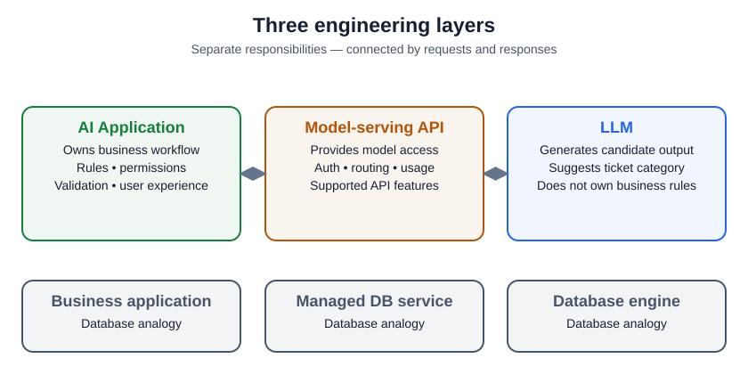
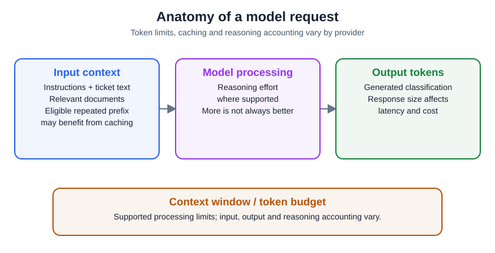
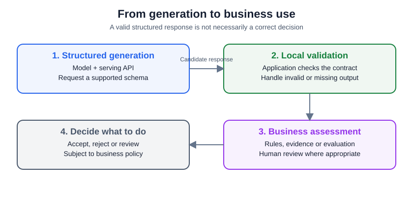
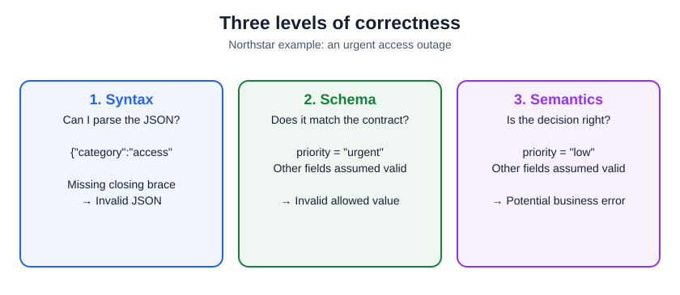
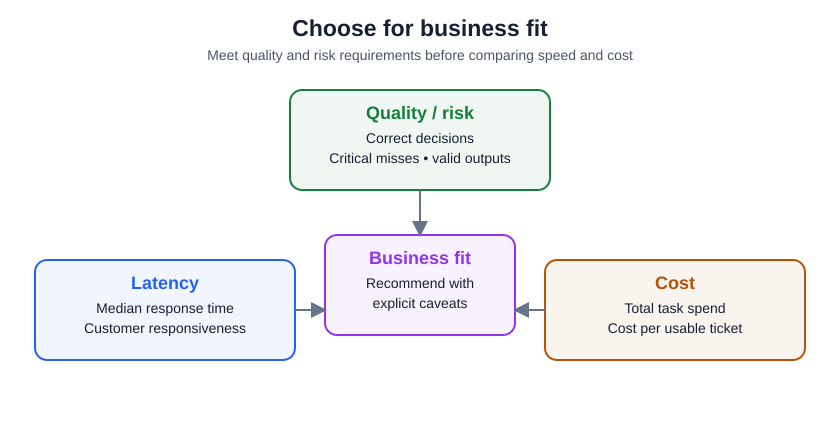

# S02 Learner Handout — Structured Outputs and Choosing a Model

**AI-Focused Forward Deployed Engineering · Session 02 · 90 minutes**
**Case study:** Northstar Support Systems (fictional) · Comparing model configurations for ticket triage

Northstar already has a model that answers tickets. Can we trust its decisions? Which model configuration should we choose?

Three questions guide this session:

- **System:** Who does what — the model, serving API or application?
- **Output:** Is the response valid, and is the decision correct?
- **Selection:** Which configuration meets our business needs?

## 🎯 What you will learn

- Distinguish an LLM, serving API and AI application.
- Understand tokens, context windows, reasoning effort and prompt caching.
- Define and validate a structured-output contract with Pydantic.
- Separate valid outputs from correct business decisions.
- Compare model configurations using quality, latency and cost.

S02 focuses on model responses, not tool-using agents. S01 covers agent loops and controls. Either session can be taken independently.

## 1. Who does what? Three engineering layers



| Layer | Responsibility | Northstar example |
|---|---|---|
| LLM | Generate candidate answers | Suggest a ticket category |
| Serving API / gateway | Access, authentication, routing, metering and supported features | Deliver model requests and responses |
| AI application | Business context, rules, validation, permissions, errors, persistence and UI | Decide whether to use the answer |

**Think of it as:** A database engine, a managed database service and the business application using it. Buying model access is not building an AI product.

## 2. What happens in a model request?



| Concept | Meaning | Why it matters |
|---|---|---|
| Token | Model-specific text unit, not necessarily a word | Usage and billing |
| Input context | Instructions, ticket text and relevant documents | More noise can hurt quality and raise cost |
| Context window | Supported token budget | Limits how much can be processed |
| Output tokens | Tokens generated by the model | Response length, cost and latency |
| Reasoning effort | Setting that may allocate more inference work | More effort is not always better |
| Prompt caching | Reuse of eligible prompt prefixes, not final answers | Potential savings depend on provider rules |

A generated rationale is not a reliable trace of internal reasoning.

## 🛠️ Forward Deployed Engineer Decision Challenge

**Scenario:** Support calls login/SSO problems “account issues”; Engineering calls them “access issues.” Existing scripts use three names for the human-escalation field.

Before seeing the contract below, agree on:

- A common taxonomy and field names.
- A typed contract and definition of a critical error.
- A provisional model recommendation, or evidence needed to make one, with a caveat.

**Deliverable:** Acceptance-criteria checklist covering these decisions. **10–15 minutes.**

[Full exercise, rubric and worked examples](../../docs/fde-exercises/structured-output-model-decision.md)

## 3. Structured output — Generation is not validation



| Concept | Responsibility |
|---|---|
| Structured generation | Model and serving API produce output using a supported schema, when configured |
| Local validation | Application checks the returned values against its contract |
| Business correctness | Rules, evidence, evaluations or human review assess the decision |

**Think of it as:** An API response contract and DTO validation. A response that matches the contract can still contain incorrect business data.

Northstar needs predictable data, not arbitrary prose.

**Response example**

```json
{
  "category": "access",
  "priority": "high",
  "needs_human": true,
  "summary": "Administrator cannot sign in before a customer demo."
}
```

S02’s example adds `summary` and omits S01’s `ticket_id`; these are session-specific contracts.

### Validate the contract with Python

**Requirements:** Python 3.11+ and `pydantic>=2` (`python -m pip install 'pydantic>=2'`).

```python
from typing import Literal
from pydantic import BaseModel, Field, ValidationError

class TicketDecision(BaseModel):
    category: Literal["billing", "technical", "access", "general"]
    priority: Literal["low", "medium", "high"]
    needs_human: bool
    summary: str = Field(min_length=1, max_length=240)

valid = {
    "category": "access",
    "priority": "high",
    "needs_human": True,
    "summary": "Admin cannot sign in before a customer demo.",
}

print(TicketDecision.model_validate(valid).priority)  # high

try:
    TicketDecision.model_validate({**valid, "priority": "urgent"})
except ValidationError as exc:
    print("Rejected invalid priority:", exc.errors()[0]["loc"])
```

**Expected behavior:** The first object validates and prints `high`; the second raises a
validation error for `priority`. This checks Python dictionaries locally, not raw JSON syntax or model generation. Pydantic may coerce types by default.

Provider-side structured generation may constrain output to a supported schema. Still handle errors, refusals, incomplete responses and wrong decisions.

### Three separate questions



1. **Syntax:** Is the response valid JSON?
2. **Schema:** Does it match the expected types and allowed values?
3. **Semantics:** Is the category/priority actually correct for this ticket?

A response can pass checks 1 and 2 and still fail check 3. A correctly formatted high-risk
decision is not automatically safe or authorized.

## 4. 🧩 Mini case: Northstar's support ticket

**Synthetic ticket:**

> "A newly onboarded administrator receives an SSO 403 error after group sync. The customer
> has a product demonstration in two hours."

Discuss before querying a model:

- Which category seems appropriate?
- Which signals establish priority: impacted users, urgency, service level, or customer impact?
- What missing information could change the decision?
- Who should define the official priority rubric?

> [!IMPORTANT]
> The *reference label* should come from an agreed rubric or subject-matter expert — not
> simply from whichever model answers first.

## 5. Which configuration fits the business?



- **Model capability:** What can the model do?
- **Configuration:** How are we using it (model ID, settings and supported features)?
- **Business suitability:** Does this configuration meet our requirements?

Meet quality and risk requirements first; then compare latency and cost.

Benchmarks help shortlist models, not select a winner. Use the same synthetic tickets, labels, prompt, contract, scoring rules and comparable settings. Change only the variable under test.

| Metric | How to measure |
|---|---|
| Task agreement — how often right? | Correct category AND priority / all attempted tickets (not all contract fields) |
| Critical miss count — serious errors? | Count high-priority tickets labeled low (exercise rubric) |
| Schema success — usable output? | Valid usable outputs / attempted calls |
| Latency — how long? | Median request time; percentiles only with enough samples |
| Cost per completed ticket — how much? | Total measured spend, including retries / usable completed tickets |

### Simple evaluation code

```python
def score(predictions: list[dict], labels: list[dict]) -> dict:
    if len(predictions) != len(labels):
        raise ValueError("Prediction and label counts must match")
    correct = sum(
        p.get("category") == y["category"]
        and p.get("priority") == y["priority"]
        for p, y in zip(predictions, labels)
    )
    return {
        "correct": correct,
        "total": len(labels),
        "agreement": correct / len(labels) if labels else None,
    }
```

**Scoring note:** Keep predictions aligned with labels; use `{}` for failed or unusable responses. Count every attempted ticket. Record API errors, refusals and incomplete/unparseable outputs separately. This function measures agreement only.

### Which would you choose?

Illustrative numbers only — not actual model results. Both configurations attempt ten tickets and return ten valid outputs.

| Metric | A | B |
|---|---:|---:|
| Correct category and priority | 9/10 | 8/10 |
| Critical misses | 1 | 0 |
| Median latency | 0.8 s | 1.5 s |
| Total cost | $0.020 | $0.040 |
| Cost per usable ticket | $0.002 | $0.004 |

A is faster, cheaper and more accurate overall. B may be preferable if critical misses are unacceptable. Neither small sample proves production reliability. What would you recommend, and why?

### Live comparison worksheet

| | Configuration A | Configuration B |
|---|---|---|
| Provider + exact model ID | | |
| Run date + settings | | |
| Tickets attempted | | |
| Valid outputs | | |
| Correct category + priority | | |
| Critical high-to-low misses | | |
| Median latency | | |
| Total measured API cost | | |
| Cost per usable completed ticket | | |
| Recommendation and caveat | | |

8–12 tickets teach measurement, not production reliability. Use representative data, repeated runs where appropriate, separate tuning/holdout sets and business-reviewed labels.

## 6. 🧩 Choosing a model: a practical FDE decision

Do **not** automatically choose the highest-ranked, fastest, or cheapest model.

Instead:

1. Agree with the customer on **acceptable quality and unacceptable failure types**.
2. Evaluate a small shortlist on **representative business tasks**.
3. Compare quality against **latency and total task cost**.
4. Investigate disagreements and failures, especially critical misses.
5. Recommend an approach with explicit limitations and additional tests before deployment.

**Sample customer-facing conclusion:**

> "Configuration A was faster on our small demonstration set, but it missed one urgent
> access issue. Before choosing it, we need the customer's escalation threshold and a
> larger, reviewed evaluation set."

## 7. Common pitfalls

- **"Pydantic means the decision is correct."** It validates structure, not business truth.
- **"The top benchmark model wins every workflow."** Rankings use their own tasks and scoring methods.
- **"More reasoning always improves answers."** Measure the trade-off; do not assume it.
- **"Open-weight models have zero cost."** Compute, hosting, operations, and latency still matter.
- **"A free endpoint is appropriate for customer tickets."** Use synthetic examples unless the provider's data-handling and authorization requirements are verified.
- **"The model can enforce our business permissions."** Authorization belongs to trusted application code or infrastructure.

## 8. ✅ Check your understanding

1. An LLM returns valid JSON with `priority="low"` for an urgent account outage. Which layer(s) can detect that this is a business error?
2. A structured-output request fails to produce a usable response. Should you omit the case when computing task success? Why?
3. What must remain constant when comparing two model configurations?
4. Why could a slower, slightly more expensive model still be preferable to the cheapest model?
5. Which responsibilities belong to the LLM, serving API and application?

<details>
<summary>Suggested answers</summary>

1. The application must check task-specific correctness using a rubric, tests, escalation rules, or human review; the serving API and schema checks cannot guarantee semantic correctness.
2. No. Count and report failures explicitly; dropping them inflates performance.
3. Test set, label definitions, prompts, output contract, scoring rules, and comparable settings — except the variable intentionally under test.
4. It may meet a required risk or accuracy threshold that the cheaper model misses.
5. The LLM proposes, the serving API provides access and supported features, and the application validates and controls how the output is used.

</details>

## 📚 Further reading

- [Anthropic — Building Effective Agents](https://www.anthropic.com/research/building-effective-agents) — workflow-versus-agent mental models.
- [Pydantic documentation](https://docs.pydantic.dev/latest/) — Python data validation and contracts.
- [Artificial Analysis](https://artificialanalysis.ai/) — model candidate discovery and public comparisons; verify methodology and observation date.
- [OpenAI API documentation](https://platform.openai.com/docs/overview) — request/response and structured-output features (provider-specific).

---

## 🗺️ Session recap

- **System:** The model proposes; the API serves; the application controls.
- **Output:** Generate a structured response, validate the contract, assess business correctness.
- **Selection:** Meet quality and risk requirements, then compare speed and cost.

**What you practice:** Pydantic validation, identifying valid-but-wrong decisions, and comparing configurations. Use synthetic data. Verify provider model IDs, features, pricing, caching and data-handling rules before production.

**Related session:** S01 covers tool-using loops, harness controls and bounded retries when one model decision is insufficient. Either session can be taken independently.

---

## About the mentor

**Sanjay Negi** brings 23+ years of industry experience and helps experienced software engineers and technology leaders transition into high-value AI roles, including **AI Engineer**, **Forward Deployed Engineer**, and **GenAI Architect**. He has trained more than 1,100 experienced engineers.

<p align="center"></p>

<p align="center"><strong>#SkillUpWithSanjay</strong></p>

<p align="center"><a href="https://www.sanjaynegi.in" target="_blank" rel="noopener noreferrer">Website</a>&nbsp;&middot;&nbsp;<a href="https://www.linkedin.com/in/sanjay-negi-ai/" target="_blank" rel="noopener noreferrer">LinkedIn</a></p>
