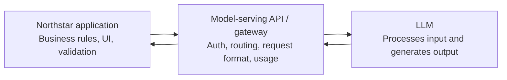

# S02 Learner Handout — Structured Outputs and Choosing a Model

**AI-Focused Forward Deployed Engineering · Session 02 · 90 minutes**
**Case study:** Northstar Support Systems (fictional) · Comparing model configurations for ticket triage

Northstar's support team already has a model that answers. The harder question is whether
anyone should trust that answer enough to build a business process on top of it — and which
of two candidate setups actually earns that trust.

## 🎯 What you will learn

By the end of this session, you should be able to:

1. Distinguish an **LLM**, a **model-serving API/gateway**, and an **AI application**.
2. Explain why tokens, context windows, reasoning settings, and prompt caching matter to application engineering.
3. Define and validate a typed **structured-output contract** using Pydantic.
4. Distinguish **valid output** from **correct business decisions**.
5. Compare two model configurations using task quality, latency, and cost — not headline rankings alone.

> [!NOTE]
> This session does not build a tool-using agent. If you want the model-directed loop,
> harness, and verification mechanics, see **S01: Verified Agent Loops** — either before
> or after this one, since the two sessions don't depend on each other.

## 1. 🧩 Three engineering layers



| Layer | Responsible for | Example question |
|---|---|---|
| **LLM** | Generating candidate content or structured values | Can it correctly identify the ticket category? |
| **Serving API / gateway** | Exposing the model, transport, authentication, metering, supported API features | Does this endpoint support structured responses? |
| **Your application** | Business context, validation, error handling, permissions, persistence, user experience | What happens if the classification is plausible but wrong? |

> [!IMPORTANT]
> **Engineering analogy:** A database engine, a managed database service, and the business
> application built on it are related but not the same component. Likewise, a model is not
> an entire AI product — "we bought an LLM API" is not the same claim as "we have a
> customer support product."

## 2. 🧩 LLM operational vocabulary

| Term | Practical meaning | Engineering implication |
|---|---|---|
| **Token** | A model-specific unit of text representation | Input and output usage often drives billing. A token is not always a word. |
| **Input context** | Instructions, ticket text, relevant documents, and other information supplied to the model | Bigger or noisier context can increase cost and reduce useful signal. |
| **Context window** | The supported budget of tokens a model can process within its API constraints | Long histories and documents require explicit management. |
| **Output tokens** | Tokens generated by the model | Response length affects latency and cost. |
| **Reasoning effort** | Provider/model-specific setting that may allocate more inference work | Higher settings may cost more without helping your particular task. |
| **Prompt caching** | Provider-specific reuse of eligible repeated prompt prefixes | Potential savings depend on the actual service's rules and reported usage. |

> [!TIP]
> **📎 Reminder:** An explanation or *rationale* a model generates is not a guaranteed
> faithful record of its internal computation — treat it as a user-facing string, not a
> trace.

## 🛠️ Forward Deployed Engineer Decision Challenge

**Customer scenario:** two prototype scripts already disagree on Northstar's ticket
taxonomy — Support says "account issues," Engineering says "access issues" for the same
login/SSO problems, and the human-escalation field has three different names across the
existing code.

**Engineering decision:** agree on one canonical taxonomy that reconciles both
stakeholders, define the typed contract for it, and define what makes a
misclassification *critical* rather than just wrong.

**Your deliverable:** an acceptance-criteria checklist — taxonomy table, contract
sketch, critical-error definition, model recommendation with one caveat. ~10–15 minutes.
Do this **before** reading the contract below — it already shows the agreed taxonomy, so
deciding it yourself only works if you haven't seen the answer yet.

**Full exercise, rubric, and worked examples:**
[`docs/fde-exercises/structured-output-model-decision.md`](../../docs/fde-exercises/structured-output-model-decision.md)

## 3. 💻 Structured output: the API contract

Imagine an internal support-triage service for **Northstar Support Systems**. A downstream
application needs data it can interpret reliably — not a paragraph in arbitrary prose.

**Response example**

```json
{
  "category": "access",
  "priority": "high",
  "needs_human": true,
  "summary": "Administrator cannot sign in before a customer demo."
}
```

### Validate the contract with Python

**Requirements:** Python 3.11+ and `pydantic>=2` (`python -m pip install 'pydantic>=2'`).

> [!TIP]
> **📎 Reminder:** A typed contract is a validation rule, not a correctness guarantee.
> Keep that distinction in mind for every snippet below.

```python
from typing import Literal
from pydantic import BaseModel, Field, ValidationError

class TicketDecision(BaseModel):
    category: Literal["billing", "technical", "access", "general"]
    priority: Literal["low", "medium", "high"]
    needs_human: bool
    summary: str = Field(min_length=1, max_length=240)

valid = {
    "category": "access",
    "priority": "high",
    "needs_human": True,
    "summary": "Admin cannot sign in before a customer demo.",
}

print(TicketDecision.model_validate(valid).priority)  # high

try:
    TicketDecision.model_validate({**valid, "priority": "urgent"})
except ValidationError as exc:
    print("Rejected invalid priority:", exc.errors()[0]["loc"])
```

**Expected behavior:** The first object validates and prints `high`; the second raises a
validation error for `priority`. This snippet demonstrates **local validation**. It does
**not** call an LLM or guarantee that a model always follows this schema.

A provider's structured-output feature may constrain generation to a supported schema,
while application validation checks the returned result. Even with both mechanisms, you
must handle errors, refusals, incomplete responses, and incorrect decisions.

### Three separate questions

1. **Syntax:** Is the response valid JSON?
2. **Schema:** Does it match the expected types and allowed values?
3. **Semantics:** Is the category/priority actually correct for this ticket?

A response can pass checks 1 and 2 and still fail check 3. A correctly formatted high-risk
decision is not automatically safe or authorized.

## 4. 🧩 Mini case: Northstar's support ticket

**Synthetic ticket:**

> "A newly onboarded administrator receives an SSO 403 error after group sync. The customer
> has a product demonstration in two hours."

Discuss before querying a model:

- Which category seems appropriate?
- Which signals establish priority: impacted users, urgency, service level, or customer impact?
- What missing information could change the decision?
- Who should define the official priority rubric?

> [!IMPORTANT]
> The *reference label* should come from an agreed rubric or subject-matter expert — not
> simply from whichever model answers first.

## 5. 🔍 Compare models on the actual task

Public model benchmarks can help choose candidates. They are not proof that a model is
right for your specific customer workflow.

Use the **same synthetic tickets**, **same scoring rubric**, and as many identical request
settings as the APIs support. Change only the model or configuration you intend to test.

| Measurement | How to assess it | Why it matters |
|---|---|---|
| **Task agreement** | Correct category **and** priority divided by all test cases | Measures usefulness under the exercise's rubric |
| **Critical miss rate** | Number of truly high-priority tickets incorrectly assigned low priority | Shows a consequential failure hidden by aggregate scores |
| **Schema success** | Valid, usable outputs divided by attempted calls | Captures interface reliability |
| **Latency** | Elapsed time per request; report a median, and percentiles only with enough samples | Affects customer-facing responsiveness |
| **Cost per completed ticket** | Total measured spend / usable completed tickets | Includes retries and provider-specific token charges |

### Simple evaluation code

```python
def score(predictions: list[dict], labels: list[dict]) -> dict:
    if len(predictions) != len(labels):
        raise ValueError("Prediction and label counts must match")
    correct = sum(
        p.get("category") == y["category"]
        and p.get("priority") == y["priority"]
        for p, y in zip(predictions, labels)
    )
    return {
        "correct": correct,
        "total": len(labels),
        "agreement": correct / len(labels) if labels else None,
    }
```

> [!WARNING]
> **Use this only as one scoring component.** Record API errors, refused/incomplete
> responses, and unparseable outputs separately. Do not silently remove failures from the
> denominator — that flatters whichever configuration fails more often.

### Live comparison worksheet

| | Configuration A | Configuration B |
|---|---|---|
| Provider + exact model ID | | |
| Run date + settings | | |
| Tickets attempted | | |
| Valid outputs | | |
| Correct category + priority | | |
| Critical high-to-low misses | | |
| Total or median latency | | |
| Total measured API cost | | |
| Recommendation and caveat | | |

An 8–12-ticket exercise teaches measurement mechanics, **not** production-grade statistical
confidence. A real evaluation needs broader and representative data, repeated runs where
appropriate, separate tuning/holdout sets, and business-reviewed labels.

## 6. 🧩 Choosing a model: a practical FDE decision

Do **not** automatically choose the highest-ranked, fastest, or cheapest model.

Instead:

1. Agree with the customer on **acceptable quality and unacceptable failure types**.
2. Evaluate a small shortlist on **representative business tasks**.
3. Compare quality against **latency and total task cost**.
4. Investigate disagreements and failures, especially critical misses.
5. Recommend an approach with explicit limitations and additional tests before deployment.

**Sample customer-facing conclusion:**

> "Configuration A was faster on our small demonstration set, but it missed one urgent
> access issue. Before choosing it, we need the customer's escalation threshold and a
> larger, reviewed evaluation set."

## 7. Common pitfalls

> [!WARNING]
> Watch for these six claims — each sounds reasonable and each is wrong.

- **"Pydantic means the decision is correct."** It validates structure, not business truth.
- **"The top benchmark model wins every workflow."** Rankings use their own tasks and scoring methods.
- **"More reasoning always improves answers."** Measure the trade-off; do not assume it.
- **"Open-weight models have zero cost."** Compute, hosting, operations, and latency still matter.
- **"A free endpoint is appropriate for customer tickets."** Use synthetic examples unless the provider's data-handling and authorization requirements are verified.
- **"The model can enforce our business permissions."** Authorization belongs to trusted application code or infrastructure.

## 8. ✅ Check your understanding

1. An LLM returns valid JSON with `priority="low"` for an urgent account outage. Which layer(s) can detect that this is a business error?
2. A structured-output request fails to produce a usable response. Should you omit the case when computing task success? Why?
3. What must remain constant when comparing two model configurations?
4. Why could a slower, slightly more expensive model still be preferable to the cheapest model?
5. What did **S01** already show you about the next step once a model starts selecting the next tool/action, rather than application code fixing every step?

<details>
<summary>Suggested answers</summary>

1. The application must check task-specific correctness using a rubric, tests, escalation rules, or human review; the serving API and schema checks cannot guarantee semantic correctness.
2. No. Count and report failures explicitly; dropping them inflates performance.
3. Test set, label definitions, prompts, output contract, scoring rules, and comparable settings — except the variable intentionally under test.
4. It may meet a required risk or accuracy threshold that the cheaper model misses.
5. The system gains model-directed workflow decisions, which require tool execution and the harness/verification controls covered in **S01: Verified Agent Loops**.

</details>

## 📚 Further reading

- [Anthropic — Building Effective Agents](https://www.anthropic.com/research/building-effective-agents) — workflow-versus-agent mental models.
- [Pydantic documentation](https://docs.pydantic.dev/latest/) — Python data validation and contracts.
- [Artificial Analysis](https://artificialanalysis.ai/) — model candidate discovery and public comparisons; verify methodology and observation date.
- [OpenAI API documentation](https://platform.openai.com/docs/overview) — request/response and structured-output features (provider-specific).

---

> [!TIP]
> **Expected takeaways:** An LLM output becomes an engineering component when its contract
> is explicit, its errors are handled, and its usefulness is measured against a real task —
> not against a leaderboard. Adding tool-directed autonomy (S01) is a separate decision,
> made only when the task genuinely needs it.

> [!NOTE]
> External model IDs, provider support, prices, and caching rules change over time. Verify
> them in the provider's current documentation before choosing a production configuration.

## 🗺️ What you have built, and what's next

**What you have built:** a validated `TicketDecision` contract, a working demonstration
of a structure-valid-but-wrong decision, and a task-first, failure-aware comparison
between two configurations — scored by critical-miss rate, not just aggregate accuracy.

**What limitations remain:** the 8–12-ticket comparison teaches measurement mechanics,
not production-grade statistical confidence. Nothing here chooses *when* the model
should act autonomously versus defer to a tool-using loop — that's a separate decision.

**What the next session adds:** **S01: Verified Agent Loops** adds the mechanism for
when a single structured decision isn't enough — when the task needs a tool-using loop,
a harness, and bounded retries around *multiple* model requests. The two sessions don't
depend on each other and can be taken in either order.

---

## About the mentor

**Sanjay Negi** brings 23+ years of industry experience and helps experienced software engineers and technology leaders transition into high-value AI roles, including **AI Engineer**, **Forward Deployed Engineer**, and **GenAI Architect**. He has trained more than 1,100 experienced engineers.

<p align="center"></p>

<p align="center"><strong>#SkillUpWithSanjay</strong></p>

<p align="center"><a href="https://www.sanjaynegi.in" target="_blank" rel="noopener noreferrer">Website</a>&nbsp;&middot;&nbsp;<a href="https://www.linkedin.com/in/sanjay-negi-ai/" target="_blank" rel="noopener noreferrer">LinkedIn</a></p>
