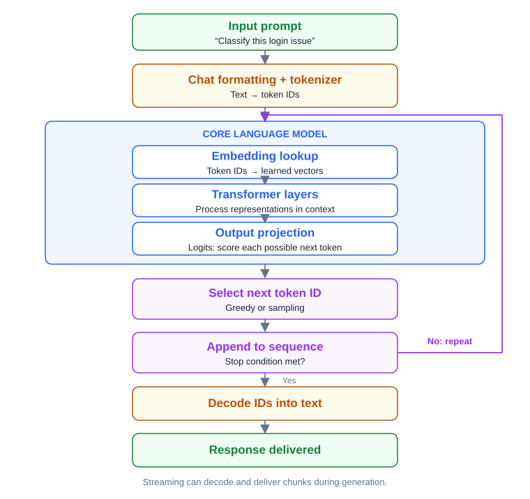
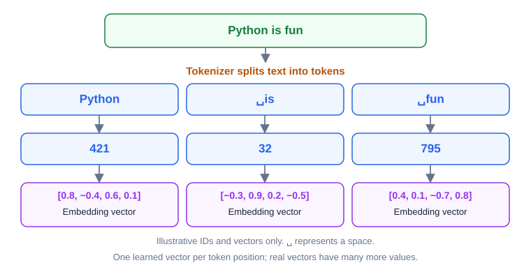
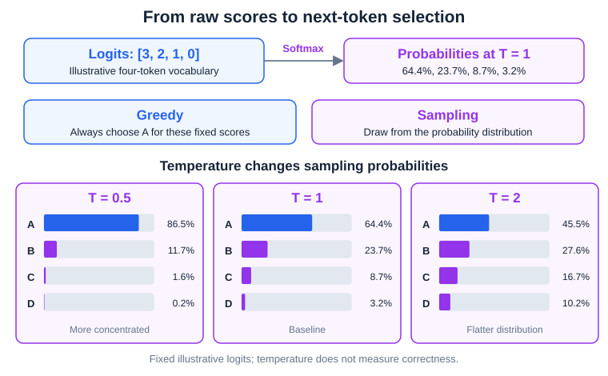
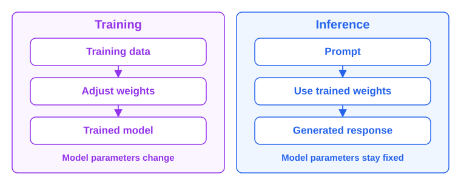
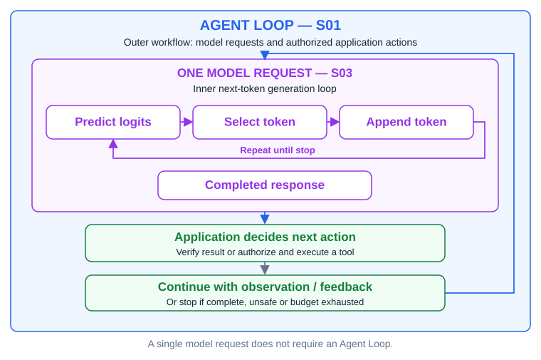
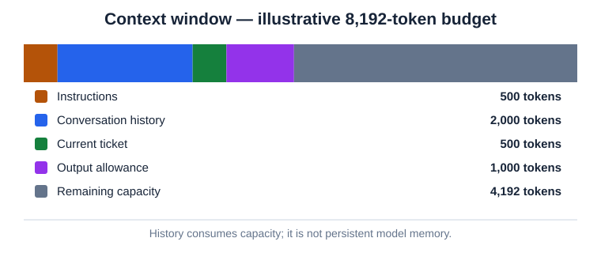
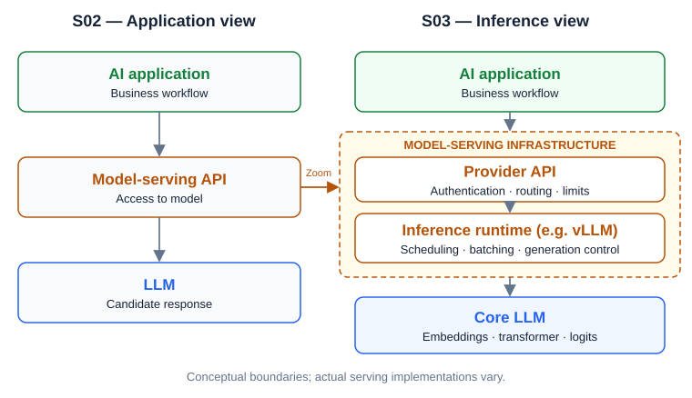
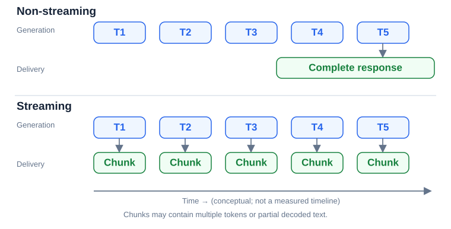
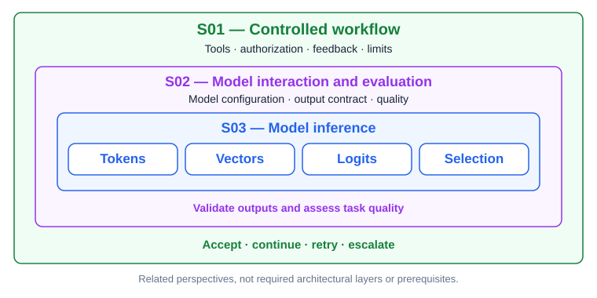

# S03 Learner Handout — LLM Fundamentals

**AI-Focused Forward Deployed Engineering · Session 03 · 90 minutes**  
**Case study:** Model mechanics and Northstar Support Systems (fictional)

Why does the same type of support ticket sometimes cost more to classify? Does streaming make an LLM faster? Does a model learn from each request?

To answer these questions, we need to understand what happens inside a model call — without becoming AI researchers.

## 🎯 What you will learn

- Trace text through tokenization, embeddings, logits and next-token selection.
- Distinguish training from inference, and generation loops from agent loops.
- Understand sampling, temperature, context windows and streaming.
- Separate the LLM, inference runtime and provider API.
- Make engineering decisions about token budgets, latency and cost.

This session covers model mechanics, not agent orchestration or retrieval.

## Pillar 1 — How does an LLM generate a response?

## 1. Follow the journey of a prompt



A model generates new tokens rather than reversing the input pipeline. The tokenizer converts between text and IDs; the model predicts which ID should come next.

We will follow the stages in this diagram throughout the session.

## 2. Tokens, token IDs and embeddings

| Concept | Simple meaning |
|---|---|
| Token | A piece of text: a word, fragment, punctuation or whitespace |
| Token ID | An integer identifying a token in the vocabulary |
| Tokenizer | Converts text into token IDs and decodes IDs back into text |
| Embedding | A learned numerical vector representing a token |



**Think of it as:** serialization followed by a dictionary lookup. The ID is a key, not a measure of importance. The embedding is the numerical data retrieved using that key.

A tokenizer is not an LLM. It cannot independently predict meaningful next tokens.

Try these with the tokenizer loaded in your lab:

```python
tokenizer.encode("unbelievable!")
tokenizer.encode("Python is fun 🐍")
```

Compare the token counts. Different tokenizers may split the same text differently.

### Embedding shapes

For a prompt containing five tokens and a model with 576-dimensional embeddings:

- Token IDs: `[1, 5]` — one prompt, five IDs.
- Embeddings: `[1, 5, 576]` — five vectors, each containing 576 numbers.

The embedding layer is inside the trained model; no separate embedding-service call is required.

**Engineering takeaway:** Token counts, not word counts, determine context usage and often influence billing.

## 3. Transformer processing, logits and token selection

The transformer layers process the numerical representations in context. The output projection then produces a score, called a **logit**, for every vocabulary token at the prediction position.

| Embeddings | Logits |
|---|---|
| Represent input tokens | Score possible next tokens |
| One vector per token position | One score per vocabulary token at the prediction position |
| Used to process information | Used to select what to generate |

Softmax converts logits into probabilities. A selection rule chooses the next token.



The model is choosing a new token, not reconstructing the original input.

**Important:** A generated explanation of the model's reasoning is itself model output. It is not guaranteed to be a faithful record of the internal computation. Evaluate it like any other generated text.

## Pillar 2 — Why does the model behave this way?

## 4. Training vs. inference



- **Training:** adjusts model weights using data.
- **Inference:** uses the trained weights to produce predictions. Ordinary inference does not update them.

A small teaching model, such as SmolLM2-135M-Instruct, demonstrates the same basic autoregressive generation mechanism used by much larger language models.

## 5. The next-token generation loop

The model predicts the next token, appends it to the sequence and repeats until a stopping condition is reached.

A simplified greedy loop (using the model, PyTorch and input IDs already loaded in the lab):

```python
for step in range(12):
    next_logits = model(current_ids).logits[:, -1, :]
    next_id = torch.argmax(next_logits, dim=-1, keepdim=True)
    current_ids = torch.cat([current_ids, next_id], dim=-1)
```

This teaching sketch generates 12 tokens without checking for an early stop. `model.generate(...)` manages generation for you. Real inference runtimes also use a **KV cache** to reuse earlier computations rather than recomputing the entire prefix at every step.

### Generation Loop vs. Agent Loop (S01)



| | Generation Loop | Agent Loop |
|---|---|---|
| Purpose | Generate one response | Complete a larger task |
| Iteration | Select and append a token | Model decision and possible application action |
| Managed by | Inference runtime | Application or agent framework |
| Stop | End token, output cap or configured stop | Completion, verification, budget or escalation |

**Think of it as:** an inner loop and an outer loop. One model request can contain many generation iterations. A single model call does not require an Agent Loop.

## 6. Greedy decoding, sampling and temperature

| Concept | What it does |
|---|---|
| Greedy decoding | Selects the highest-scoring next token |
| Sampling | Randomly selects a token using a probability distribution |
| Temperature | Changes how concentrated that distribution is |

Lower temperature makes sampling more concentrated around high-scoring tokens. Higher temperature makes alternatives more likely. See the probability panels in Section 3.

Greedy selection is deterministic for fixed scores and tie-breaking, but complete reproducibility across requests or environments is not guaranteed.

For Northstar ticket classification, repeatability may be valuable. Brainstorming may benefit from variety. Evaluate the available settings on the actual task (S02).

**Engineering takeaway:** Temperature is a product decision, not a correctness knob.

## 7. Context window — A budget, not memory

The context window limits the tokens available to a model during inference. Instructions, conversation history, documents and generated tokens generally share this capacity, subject to provider-specific limits.



**Think of it as:** a limited processing buffer, not permanent storage.

Relevant history must be made available for later requests, either by the application or by a provider-managed conversation service. Ordinary inference does not store conversation history in the model's weights.

Longer inputs generally increase resource usage and may increase cost and latency; caching and serving optimizations can affect the actual outcome. Irrelevant context may also reduce useful signal.

## Pillar 3 — How does this affect my application?

## 8. LLM vs. inference runtime vs. provider API



| Component | Responsibility |
|---|---|
| Core LLM | Uses trained weights to compute predictions |
| Inference runtime | Runs the model, manages generation, batching and scheduling |
| Provider API | Exposes model access, authentication, routing and API controls |
| AI application | Uses model responses within a business workflow |

This is a more detailed view of S02's model-serving layer, not a competing architecture.

`vLLM` is an example of an inference runtime, not an LLM or an agent. Tokenization, selection and decoding are supporting operations whose placement can vary by implementation.

With hosted APIs, the runtime usually manages the generation loop. You typically control supported settings such as output limits, sampling and streaming. Raw logits are generally not exposed, although some APIs provide token log probabilities.

## 9. Streaming vs. non-streaming



| Non-streaming | Streaming |
|---|---|
| Receive a completed response | Receive partial chunks progressively |
| Simple backend consumption | Earlier visible feedback in a UI |
| Suitable for ticket classification | Useful for interactive chat |

**Think of it as:** a regular HTTP response versus a streamed HTTP response.

Streaming changes delivery, not the basic generation mechanism. Chunks need not match individual tokens. It does not inherently reduce model compute or guarantee faster completion; actual end-to-end latency depends on implementation.

For Northstar's backend classification, non-streaming is a reasonable starting point.

## 10. Northstar — Why token budgets matter

Northstar asks why similar tickets can have different classification costs. One possible reason: some requests include the entire conversation, while others contain just the current ticket.

Illustrative prices: $1 per million input tokens and $4 per million output tokens. Assume 10,000 tickets per month and 60 output tokens per ticket.

| | Short input | Full thread |
|---|---:|---:|
| Input tokens per ticket | 500 | 5,000 |
| Cost per ticket | $0.00074 | $0.00524 |
| Monthly token cost | $7.40 | $52.40 |

```python
def estimate_usd(input_tokens, output_tokens,
                 input_usd_per_m, output_usd_per_m):
    return (input_tokens * input_usd_per_m
            + output_tokens * output_usd_per_m) / 1_000_000

estimate_usd(500, 60, 1.00, 4.00)   # 0.00074
estimate_usd(5000, 60, 1.00, 4.00)  # 0.00524
```

The difference is $45 per month at this illustrative volume. These are hypothetical prices and token counts, excluding retries, caching discounts and other charges.

**Engineering trade-off:** Trimming history may reduce cost but remove information needed for correct classification. Evaluate the impact before adopting a pruning policy.

## 🛠️ Forward Deployed Engineer Decision Challenge

**Customer scenario:** Northstar wants to process 50,000 tickets daily with predictable latency and spending.

**Your deliverable:** A short production-configuration memo (10–15 minutes) covering:

- Context budget and pruning rule, including what might be lost.
- Output cap.
- Streaming or non-streaming recommendation.
- Estimated cost range with stated assumptions.
- Latency implications, risks and unknowns.

Full exercise and rubric: [Decision challenge](../../docs/fde-exercises/llm-fundamentals-decision.md).

Optional companion notebook: `LLM_Engineering_Decisions.ipynb`.

## ✅ Check your understanding

1. How do a token, token ID and embedding differ?
2. What is the difference between embeddings and logits?
3. How do greedy decoding, sampling and temperature relate?
4. How does a Generation Loop differ from an Agent Loop?
5. Does ordinary inference change model weights?
6. Why is a context window not persistent memory?
7. What does the inference runtime do?
8. Does streaming change generation or delivery?
9. Why isn't a generated rationale a trustworthy trace of internal computation?

<details>
<summary>Suggested answers</summary>

1. Text piece, numerical identifier and learned vector, respectively.
2. Embeddings represent input tokens; logits score possible next tokens.
3. Greedy chooses the top score; sampling draws from probabilities; temperature reshapes those probabilities.
4. Generation repeats within a response; an Agent Loop coordinates model requests and actions.
5. No.
6. Relevant history must be supplied or managed by a conversation service.
7. It manages model execution and generation efficiently.
8. Delivery; the basic generation mechanism remains the same.
9. It is generated output, not a guaranteed faithful record of internal computation.

</details>

## Session recap



- **S03 — Model mechanics:** Understand how responses are generated and how settings affect application behavior.
- **S02 — Structured Outputs and Model Selection:** Define contracts, validate responses and evaluate model suitability.
- **S01 — Verified Agent Loops:** Control model-directed actions, feedback and stopping conditions.

The sessions can be taken independently. This session establishes a mental model and a token-budget calculation; the companion lab demonstrates model mechanics. It does not implement retrieval, structured-output validation or agent orchestration.

## 📚 Further reading

- [SmolLM2-135M-Instruct model card](https://huggingface.co/HuggingFaceTB/SmolLM2-135M-Instruct)
- [Hugging Face tokenizer documentation](https://huggingface.co/docs/transformers/main_classes/tokenizer)
- [Hugging Face generation documentation](https://huggingface.co/docs/transformers/main_classes/text_generation)
- [OpenAI Chat Completions API](https://platform.openai.com/docs/api-reference/chat)
- [vLLM documentation](https://docs.vllm.ai/)

---

## About the mentor

**Sanjay Negi** brings 23+ years of industry experience and helps experienced software engineers and technology leaders transition into high-value AI roles, including **AI Engineer**, **Forward Deployed Engineer**, and **GenAI Architect**. He has trained more than 1,100 experienced engineers.

<p align="center"></p>

<p align="center"><strong>#SkillUpWithSanjay</strong></p>

<p align="center"><a href="https://www.sanjaynegi.in" target="_blank" rel="noopener noreferrer">Website</a>&nbsp;&middot;&nbsp;<a href="https://www.linkedin.com/in/sanjay-negi-ai/" target="_blank" rel="noopener noreferrer">LinkedIn</a></p>
