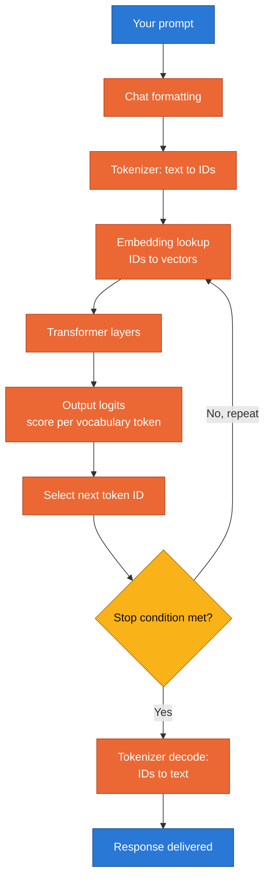
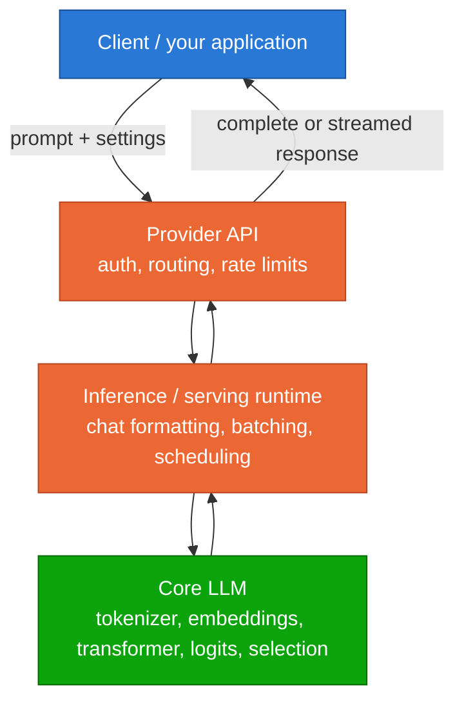

# S03 Learner Handout — LLM Fundamentals

**AI-Focused Forward Deployed Engineering · Session 03 · 90 minutes**
**Case study:** generic model mechanics, with one Northstar-framed FDE decision at the end

S00, S01, and S02 deliberately treat "the model" as a black box: something that takes a
prompt and returns text or a structured decision. That's the right abstraction for most
FDE engineering decisions — but not all of them. When a customer asks "why does the same
ticket cost more to classify some days than others," or "can we just stream the whole
response instead of waiting," the answer lives one layer below that black box. This
session opens the box just far enough to answer those questions with mechanism, not
hand-waving, and no further than that.

## 🎯 What you will learn

By the end of this session, you should be able to: explain tokenization and why a
tokenizer is not an LLM; trace a prompt through model inference end to end; explain, at an
intuitive level, what embeddings and logits are and how a next token gets selected;
distinguish inference from training; explain why a context window is a budget, not
memory; explain sampling and generation settings; compare streaming and non-streaming
delivery; distinguish a core LLM from an inference runtime from a provider API; and
connect each of those to a concrete engineering or customer-facing decision.

> [!NOTE]
> This is a **mechanics** session, not an **orchestration** or **retrieval** session. It
> does not build a tool-using agent (that's **S01: Verified Agent Loops**) and does not
> build a retrieval pipeline (a future Context Engineering and RAG session will).
> Everything here happens *inside one model response*.

## 1. 🧩 Tokens and tokenization

A **token** is the unit of text a model actually reads — a whole word, a word fragment,
punctuation, or whitespace, depending on the tokenizer. A **token ID** is the integer
standing in for that token. A **tokenizer** is the text ⇄ ID conversion algorithm plus its
learned vocabulary. **It is not the language model** — it cannot generate anything, only
translate.

Think of a tokenizer the way you'd think of a serialization format: the agreed-upon
encoding between "text a person reads" and "integers a neural network can compute with."
Different models can ship different tokenizers, so identical text can become a different
number of tokens depending on which model you ask.

```python
tokenizer.encode("unbelievable!")       # 3+ tokens: word fragments, not one "word" token
tokenizer.encode("Python is fun 🐍")     # emoji usually costs more tokens than it looks like
```

> [!TIP]
> **⚙️ Engineering implication:** token counts, not word counts, drive both your
> context-window budget and most providers' billing. "This ticket has 40 words" tells you
> nothing reliable about what it costs to classify.

## 2. 🧩 Loading the LLM, and the full prompt-to-response path

The tokenizer alone cannot answer anything — it has no trained weights. The **language
model** is a neural network trained to predict the next token from context. A small
teaching model (135M parameters) uses the same core mechanism as a flagship model many
times its size: predict the next token from everything so far.



> [!IMPORTANT]
> The output is **not the input pipeline run backward.** The model produces **new**
> vocabulary scores, picks a **new** token ID, and only then does the tokenizer decode
> that ID into text. Tokenization and decoding are roughly inverse operations of each
> other; the *whole generation process* is not.

**Two different uses of "loop," named once so neither gets confused later:** this
session's loop is the **next-token generation loop inside one model response**. A
separate, *outer* concept — an **agent loop** that makes several independent model
requests and executes tools between them — is **S01: Verified Agent Loops**'s entire
subject, not this session's. One model response can contain many next-token iterations
and still be a single step of an agent loop, or the only step if there's no agent loop at
all.

## 3. 🧩 Embeddings — the intuition, without the math

A token ID like `1234` is a label, not a magnitude — it does **not** mean that token is
"bigger" or "more important" than token `1233`. The model needs numbers it can compute
with, so it looks up a trained vector for every token ID. This **embedding layer** lives
*inside* the generative model — there's no separate service call for it.

If a prompt tokenizes to 5 tokens and the model uses 576-dimensional embeddings, the
shapes read `[1, 5]` (one prompt, five IDs) → `[1, 5, 576]` (one prompt, **one vector per
token**, 576 numbers each) — never one vector for the whole prompt.

> [!TIP]
> **⚙️ Engineering implication:** this is why "the model's context" is measured in
> tokens, and why a longer prompt is strictly more compute, every time.

## 4. 🧩 Logits and token selection

After the transformer layers process the embedding vectors, a final **output
projection** turns the result into one score — a **logit** — for *every* token in the
vocabulary. A **softmax** turns those raw scores into a probability distribution; a
selection rule (greedy, or sampling — §5) then picks one actual next token ID.

**Is this the reverse of §3?** No. Section 3 was `token ID → vector`. This is
`vector → score for every possible next ID → pick one ID`. There's no step that
reconstructs the *original* input — the model is choosing a **new** token.

> [!IMPORTANT]
> **The single most important caution in this session:** when a model "explains its
> reasoning" in generated text, that explanation was produced by this exact same
> mechanism — next-token prediction over a vocabulary — not by inspecting its own
> internal computation and reporting on it faithfully. A generated rationale is a
> plausible-sounding **output**, evaluated the same way any other generated text is, not
> a trustworthy trace of *why* the model produced its answer. This is the same caution
> **S02** states about structured-output rationales, grounded here in the mechanism that
> makes it true.

## 5. 🧩💻 Inference vs. training, and the generation loop

**Training** is the separate, offline, expensive process that adjusted this model's
weights. **Inference** is using those already-fixed weights to make a prediction —
nothing about the weights changes while an application runs. A call to
`model.generate(...)` runs the repeated "predict one token, append it, repeat" process for
you. Watching it unrolled by hand, one step at a time, makes that mechanism concrete:

```python
for step in range(12):
    next_logits = model(current_ids).logits[:, -1, :]
    next_id = torch.argmax(next_logits, dim=-1, keepdim=True)
    current_ids = torch.cat([current_ids, next_id], dim=-1)
```

Twelve iterations, one new token chosen each time, each decision made using *only* the
tokens so far — including the ones this same loop just generated. Real inference engines
cache earlier computations (the **KV cache**) so they don't redo the whole prefix every
step; this is skipped here for clarity, not because it doesn't matter in production.

> [!IMPORTANT]
> **⚙️ Engineering implication — generation loop vs. agent loop:**
> - **The loop above:** many *next-token* iterations inside **one** model response. You
>   never write this loop yourself against a hosted API — the provider runs it and
>   returns (or streams) the finished text.
> - **An agent loop** (S01's subject, not built here): the *outer* process that issues
>   several independent model **requests**, lets the model request a tool, executes that
>   tool in application code, and feeds the result back. Each step may itself contain a
>   full next-token loop like the one above. They're nested, not the same thing, and
>   conflating them is a common, costly confusion in production debugging.

**Greedy** decoding always picks the highest-scoring token — deterministic. **Sampling**
picks randomly, weighted by (temperature-adjusted) probabilities — not deterministic.
**Temperature** reshapes those probabilities: lower is more predictable, higher is more
varied (and can get worse, not just "more creative").

> [!TIP]
> **⚙️ Engineering implication:** temperature is a **product decision**, not a
> correctness knob. A classification task (S02's `TicketDecision`) usually wants greedy,
> deterministic, repeatable output; a brainstorming task might reasonably want sampling.
> Pick it from the task's actual need for repeatability, not a default.

## 6. 🧩 Context window: what can the model see?

A model's **context window** is the maximum number of tokens it can account for in one
request — instructions, conversation history, supplied documents, and the tokens it's
about to generate, all competing for the same budget. It's working memory for *this
request only*, not a notebook the model keeps across requests. If an application wants a
model to "remember" something from three turns ago, *the application* has to re-send it —
nothing persists on the model's side between calls.

> [!IMPORTANT]
> **⚙️ Engineering implication:** "the model has a huge context window" is not, by
> itself, a reason to attach everything you have to every request. More tokens means more
> cost and more latency, and irrelevant material can crowd out the signal that matters.
> This is exactly the caution **S02** raises about attaching an entire knowledge base to
> every ticket — you're now seeing *why* it's true, in tokens, not just as a rule to
> follow.

## 7. 🧩 Streaming vs. non-streaming: same generation, different delivery

The model predicts tokens one at a time **regardless** of delivery mode.

- **Non-streaming:** the serving layer collects the whole result, then returns one
  completed response. Your application typically displays it only after the call finishes.
- **Streaming:** the serving layer sends chunks as they become available, so your
  application can display text progressively.

Streaming is a UX and perceived-latency choice at the *delivery* layer — it does not
change how many tokens get generated, how much compute it takes, or the total time until
the last token exists.

> [!TIP]
> **⚙️ Engineering implication:** choose streaming for its actual benefit —
> **perceived** responsiveness in a user-facing chat UI — not because it changes total
> compute. For a backend classification call like S01/S02's ticket triage, where nothing
> is displayed token-by-token to a human, streaming usually buys you nothing.

## 8. 🧩 Three layers: LLM, inference runtime, and provider API



> [!NOTE]
> This **nests inside S02's three-layer diagram** (`Northstar application →
> model-serving API/gateway → LLM`), not a competing one. S02's "model-serving
> API/gateway" box *is* the "provider API" + "inference runtime" boxes above, zoomed out
> to decision-making depth. Same boundary, two levels of detail — pick the one the
> question in front of you needs.

A real provider may distribute these functions across different services and add
monitoring, caching, safety checks, and GPU scheduling. `vLLM` is a real example of the
"inference runtime" box — not an LLM, not a tokenizer, and not an agent.

When you call a hosted API, you never write the §5 generation loop, never touch the §3
embedding layer, and never see §4's logits directly — the provider's inference runtime
handles all of it. What you *can* usually control through API parameters: max output
tokens, sampling settings, and streaming mode — the three things this session showed you
the mechanism behind.

## 9. 🛠️ Why this matters for FDE work — Northstar's token/cost budget

Northstar's support lead looked at last month's invoice and asked: *"Why does classifying
the exact same kind of ticket cost different amounts depending on which agent submitted
it?"* The honest answer is §1 and §6, applied: agents who paste in the full conversation
history (or several related tickets) before asking for a classification are paying for
every one of those extra tokens, every single call — not because the model is
inconsistent, but because token count, not "ticket complexity," drives both cost and the
context budget.

```python
estimate_usd(input_tokens=short_ticket_tokens, output_tokens=60,
             input_usd_per_m=1.00, output_usd_per_m=4.00)
# vs. the same call with a full prior thread attached instead of just the ticket text
```

A small per-call difference projected across 10,000 tickets a month turns into a real
line item — the kind of number that actually moves a customer conversation.

> [!IMPORTANT]
> A convincing mechanism explanation is not, by itself, a policy. The moment you recommend
> a specific context-trimming rule to Northstar (e.g., "attach the current ticket plus the
> last N exchanges"), you're making an engineering trade-off on their behalf — name the
> trade-off out loud (what you might lose by trimming), the same discipline S00 and S02
> both ask for when a prompt or a model recommendation starts driving a real decision.

## 🛠️ Forward Deployed Engineer Decision Challenge

**Customer scenario:** Northstar wants to process 50,000 support tickets daily with
predictable latency and spending, before approving the recurring monthly cost.

**Engineering decision:** token-related cost drivers, a context-budget policy, the
latency implications of that budget, and a streaming-or-not recommendation — each with
its risks and unknowns stated plainly.

**Your deliverable:** a short production-configuration memo (context budget + pruning
rule, output cap, streaming decision, cost range with stated assumptions, top risks).
~10–15 minutes. This formalizes the exercise above into a full stakeholder brief — the
optional `LLM_Engineering_Decisions.ipynb` companion notebook goes further for learners
with more time.

**Full exercise, rubric, and worked examples:**
[`docs/fde-exercises/llm-fundamentals-decision.md`](../../docs/fde-exercises/llm-fundamentals-decision.md)

## ✅ Check your understanding

1. Is a tokenizer an LLM? What's the one thing it actually does?
2. Why isn't "the model generated an explanation of its reasoning" the same claim as "the
   model reported its internal computation"?
3. What's the difference between the next-token generation loop in this session and the
   agent loop S01 teaches?
4. Where does "memory" across five separate API calls actually have to live?
5. Did streaming change how tokens are generated, or when your application receives them?

> [!TIP]
> **Expected takeaways:** a tokenizer only converts text ⇄ token IDs, nothing more;
> generated "reasoning" is produced by the same next-token mechanism as any other output,
> so it's not a readout of internal computation; this session's loop is next-token
> iterations inside one model response, while an agent loop makes multiple independent
> model requests and executes tools between them; memory across calls has to live in the
> application, not the model; streaming changes when output is received, not the
> underlying generation mechanism.

## 📚 Further reading

- [SmolLM2-135M-Instruct model card](https://huggingface.co/HuggingFaceTB/SmolLM2-135M-Instruct)
- [Hugging Face tokenizer documentation](https://huggingface.co/docs/transformers/main_classes/tokenizer)
- [Hugging Face generation documentation](https://huggingface.co/docs/transformers/main_classes/text_generation)
- [OpenAI Chat Completions API](https://platform.openai.com/docs/api-reference/chat)
- [vLLM documentation](https://docs.vllm.ai/)

## 🗺️ What you have built, and what's next

**What you have built:** a working mental model of the request/response lifecycle —
tokens, embeddings, logits, the manual generation loop, context windows, and
streaming — each grounded in a real, local demonstration, plus a Northstar cost-budget
recommendation backed by actual token-count arithmetic.

**What limitations remain:** this session only covers what happens inside *one* model
response. Nothing here chooses *between* a tool-using loop and a single call, validates
a structured decision, or retrieves supporting documents — those are separate decisions
made elsewhere in this course.

**What the next sessions add:** **S01: Verified Agent Loops** adds the mechanism for
multiple model requests with tool execution and verification between them. **S02:
Structured Outputs and Model Selection** adds a typed contract for trusting a single
decision enough to automate it. Neither depends on this session or on each other.

---

## About the mentor

**Sanjay Negi** brings 23+ years of industry experience and helps experienced software engineers and technology leaders transition into high-value AI roles, including **AI Engineer**, **Forward Deployed Engineer**, and **GenAI Architect**. He has trained more than 1,100 experienced engineers.

<p align="center"></p>

<p align="center"><strong>#SkillUpWithSanjay</strong></p>

<p align="center"><a href="https://www.sanjaynegi.in" target="_blank" rel="noopener noreferrer">Website</a>&nbsp;&middot;&nbsp;<a href="https://www.linkedin.com/in/sanjay-negi-ai/" target="_blank" rel="noopener noreferrer">LinkedIn</a></p>
