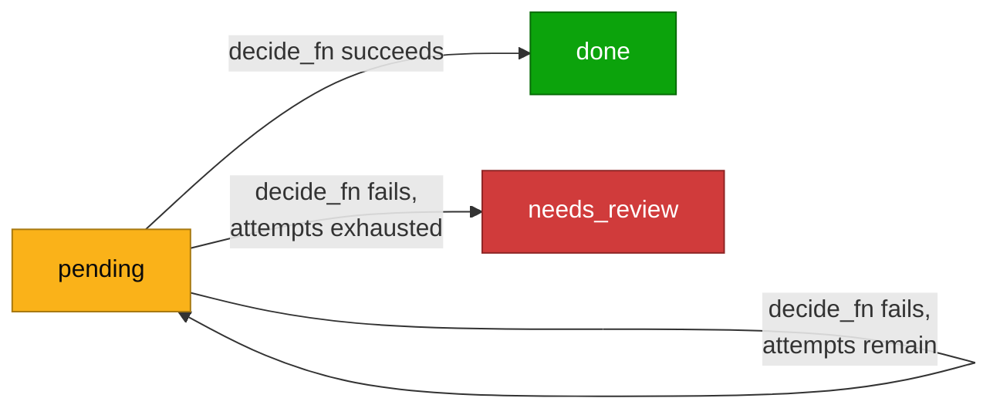

# S06 Learner Handout — Queue Harnesses: Orchestrating at Scale, Build vs. Buy

**AI-Focused Forward Deployed Engineering · Session 06 · 90 minutes**
**Case study:** Northstar Support Systems (fictional) · From one ticket to a whole queue
**Prerequisites:** **S01: Verified Agent Loops** — this session extends S01's harness
mechanics to many items instead of one. Independent of S02, S03, S04, and S05.

S01 built a bounded loop that decides **one** ticket: a model proposes, the harness
authorizes and executes a tool, a verifier checks the result, bounded retries handle
failure. This session asks the next question: what organizes the work when there are
hundreds of tickets waiting, the process can crash partway through, and some of them
fail for reasons that have nothing to do with whether the decision itself was correct?

## 🎯 What you will learn

By the end of this session, you should be able to:

1. Extend a single-item verified loop into a harness that organizes and works an entire queue on its own.
2. Design a state machine where a crash or restart can never lose a completed item or redo one that already finished — idempotency, made structural rather than bolted on.
3. Explain why giving each item a fresh, independent decision call — not one long accumulating conversation — controls cost and keeps each item's failure isolated.
4. Distinguish a transient failure (retry, bounded) from a chronic one (escalate, don't retry forever), and implement the state transition between them.
5. Compare hand-rolling this orchestration against adopting a ready-made agent framework's equivalent primitives, with real trade-offs on each side — not a default preference for either.

> [!NOTE]
> This session does not re-teach how one ticket gets decided or verified — that's S01's
> and S02's scope. The lab's "subagent" is a deterministic stand-in on purpose; the
> thing actually under test here is the orchestration around it.

## 1. 🧩 From one item to a queue: what's actually new

| S01's scope | This session's scope |
|---|---|
| One ticket, one bounded loop, one run | Many tickets, one run organizing all of them |
| A crash loses the run — rerun it | A crash must **not** lose completed work — resume exactly where it left off |
| A tool failure retries within that one ticket's loop | A ticket failure affects only that ticket; the rest of the queue keeps moving |
| The harness's job: authorize and execute one tool call safely | The harness's job: track every item's status, retry what's safe to retry, escalate what isn't, and never touch an item twice |

Nothing about *deciding* a ticket changes. What's new is entirely about **state**: what
status is each item in, how many times has it been tried, and what happens when the
process restarts.

## 2. 🧩 A state machine, not a loop with a counter

Every ticket is in exactly one of three states: `pending`, `done`, or `needs_review`.
The entire harness is the rule for moving between them:



The lab's harness (`queue_harness/core.py`) implements exactly this, and nothing else —
it has no idea what a ticket, a category, or a priority is. `decide_fn` is an injected
callable; the harness's only job is moving tickets between these three states correctly,
under a cap, across however many times it gets called.

> [!IMPORTANT]
> **Idempotency here isn't a separate check — it's a consequence of the state machine's
> shape.** Once a ticket is `done` or `needs_review`, the loop skips it; there is no code
> path that can re-decide or re-escalate it, because the loop only ever touches tickets
> whose status is `pending`. Compare this to S01's `create_escalation`, which needed an
> explicit duplicate check *within* one ticket's tool calls — a different, harder
> problem (preventing a repeated side effect inside one decision) than this one
> (preventing a finished item from being reprocessed across runs).

## 3. 💻 Crash-safe, by persisting the same state the loop reads

The harness takes a `QueueState` and mutates it in place; `main.py` persists that exact
object to disk after every run and reloads it before the next one:

```python
state = load_state(ticket_ids)       # resumes from disk if a save exists
result = work_queue(state, decide_fn, max_attempts=2, cap=args.cap)
save_state(state)                    # the next run resumes from exactly here
```

Run the lab's CLI with a small `--cap`, and you can watch this live: each run processes
only a few tickets, saves, and tells you how many are still pending. Running it again
picks up exactly where the last run stopped — nothing re-decided, nothing skipped.

> [!WARNING]
> **A real bug this lab's own build caught:** the first version of the fault-injection
> helper used below tracked "how many times has this ticket failed" in an in-memory
> counter, separate from the harness's own persisted `attempts` field. That counter
> reset every time the CLI process restarted — so a ticket meant to fail once and then
> succeed on retry instead failed *every* run, because the injector never remembered it
> had already failed once. The fix was to make the injector read the harness's own
> persisted attempt count instead of keeping separate state. **Any retry/failure logic
> that keeps its own bookkeeping, instead of reading the same persisted state the
> harness already tracks, will drift from the harness's own account of what happened —
> exactly the kind of bug that only shows up after a restart, not in a single run.**

## 4. 🧩 Why a fresh subagent per item, not one long conversation

`decide_fn(ticket_id)` is the entire interface between the harness and "whatever decides
one ticket." It receives nothing but the ticket's identity — no history of other
tickets, no accumulated conversation. This is a **structural** guarantee, not a style
preference:

- **Cost stays flat per item.** A long-running conversation that accumulates every prior
  ticket's exchange grows its own context (and cost) with every item processed — the
  10th ticket in a run costs more than the 1st, for no reason related to that ticket's
  difficulty. A fresh call per item doesn't have this problem.
- **One item's failure can't corrupt another's.** If ticket 4 produces a malformed tool
  call or a confused multi-turn exchange, that mess lives entirely inside ticket 4's own
  call. It can't leak into ticket 5's context, because ticket 5 never sees it.

> [!TIP]
> **📎 Reminder:** this is the same reasoning S04 applied to deployment configurations
> and S05 applied to context size — isolate what varies, measure it, don't let one
> item's complexity bleed into another's by sharing state that doesn't need to be
> shared.

## 5. 🧩 Build vs. buy: the same mechanism, two ways to get it

A ready-made agent-orchestration framework typically gives you a task-queue abstraction
and a subagent-delegation primitive out of the box — conceptually the same shape as
`QueueState`/`work_queue`/`decide_fn` above, in far less of your own code:

```python
# Illustrative only — no such framework is installed or executed in this lab.
queue = SomeFramework.TaskQueue(items=ticket_ids, max_attempts=2)
queue.run(handler=subagent, cap=5)
```

| | Hand-rolled (this lab) | Ready-made framework |
|---|---|---|
| **Lines of code you own and can read in full** | ~90 | Whatever the framework's internals are — usually not something you read |
| **Who decides what "done" and "retry" actually mean** | You, exactly, in `core.py` | Whatever the framework's defaults are, until you override them |
| **Debugging an unexpected escalation** | Read your own state machine | Read the framework's source, or its docs, or file an issue |
| **Model/runtime portability** | Whatever `decide_fn` happens to call | Often tied to the framework's own supported models/runtimes |
| **Time to a working first version** | Longer | Usually much shorter |

Neither column is the right answer by default. The lab's FDE decision exercise asks you
to actually weigh them for a specific Northstar scenario, not just list the trade-offs
in the abstract.

## 🛠️ Forward Deployed Engineer Decision Challenge

**Customer scenario:** Northstar's engineering lead wants to adopt a ready-made agent
framework for queue orchestration "to move faster," right after a production incident
where the framework a different team already uses silently treated a crashed run as
"nothing happened" and reprocessed — and double-escalated — forty already-handled
tickets.

**Engineering decision:** What do you actually need to verify about a framework's
checkpoint/idempotency guarantees before adopting it for this, and what would make you
recommend the hand-rolled approach instead?

**Your deliverable:** a build-vs-buy recommendation with a concrete verification plan,
~10–15 minutes.

**Full exercise, rubric, and worked examples:**
[`docs/fde-exercises/queue-harness-build-vs-buy-decision.md`](../../docs/fde-exercises/queue-harness-build-vs-buy-decision.md)

## 6. 🔍 Common pitfalls

> [!WARNING]
> Watch for these five claims — each sounds reasonable and each is wrong.

- **"A crash just means rerun it."** Only if reruning is actually safe — i.e., only if
  the state machine guarantees nothing gets redone or lost. That guarantee has to be
  designed in, not assumed.
- **"Retry logic can track its own state."** Not if that state isn't the same state the
  harness persists — see §3's real bug. Any bookkeeping that isn't the harness's own
  persisted record will drift from it after a restart.
- **"One conversation for the whole queue is simpler."** It's less code to write once,
  and it's the thing that makes cost creep with every item and lets one item's mess leak
  into the next.
- **"A framework's task queue gives you the durability guarantee we need."** Maybe — but
  that's an empirical question about that specific framework's defaults, not something
  to assume because it has a queue abstraction at all.
- **"Build vs. buy is a one-time decision."** A framework adopted for speed today is a
  dependency you're still debugging someone else's internals for later — the trade-off
  doesn't go away once you've chosen.

## ✅ Check your understanding

1. Why does this session's idempotency guarantee not need a separate duplicate check, the way S01's `create_escalation` did?
2. What specifically breaks if a retry-tracking mechanism keeps its own counter instead of reading the harness's persisted attempt count?
3. Name two concrete costs of giving every ticket in a queue access to the full conversation history of every ticket before it.
4. A framework promises "automatic retries." What question would you ask before trusting that claim for this session's use case?
5. What's the actual difference between a transient failure and a chronic one, in terms of what the harness should do with each?

<details>
<summary>Suggested answers</summary>

1. Because the state machine only ever processes tickets whose status is `pending` —
   once a ticket becomes `done` or `needs_review`, there is no code path that touches it
   again. The guarantee comes from the state machine's shape, not an added check.
2. It can silently drift from what actually happened: a ticket meant to fail once and
   then succeed on retry can instead fail every time after a restart, because the
   separate counter resets while the harness's own record of attempts doesn't — exactly
   the bug this session's own lab build caught.
3. Cost grows with every processed item regardless of that item's own difficulty
   (accumulated context gets resent every call); one item's malformed or confused
   exchange can leak into and corrupt how the next item gets decided.
4. Specifically: does "automatic retry" also guarantee no item is processed twice after
   a crash, and does it expose (or let you override) what counts as "enough attempts" —
   a retry guarantee and an idempotency guarantee are not the same promise.
5. A transient failure is one where trying again might succeed (a timeout, a momentary
   unavailability) — bounded retry is appropriate. A chronic one keeps failing for a
   reason retrying won't fix — the harness should stop retrying and hand it to a human
   instead of looping forever.

</details>

## 📚 Further reading

- This course's **S01: Verified Agent Loops** §2–§6 — the single-item harness and verification mechanics this session's queue builds on.
- [LangGraph `ToolNode`](https://reference.langchain.com/python/langgraph.prebuilt/tool_node/ToolNode) and the broader LangGraph persistence/checkpointing docs — one real framework's take on durable, resumable agent state, worth comparing against this session's hand-rolled version.

---

> [!TIP]
> **Expected takeaways:** orchestrating a queue is a state-machine design problem, not a
> bigger loop with a counter. Idempotency and crash-safety are properties you design
> into the state transitions themselves, not checks you bolt on afterward. A ready-made
> framework can give you this mechanism faster — but only if its actual durability
> guarantees match what your business needs, which is something to verify, not assume.

## 🗺️ What you have built, and what's next

**What you have built:** a queue harness (`queue_harness/core.py`) that tracks every
item's status and attempt count, retries transient failures within a bounded budget,
escalates chronic ones, and guarantees no item is ever lost or reprocessed across a
restart — exercised by a passing 17-test suite and a CLI you can watch resume live, not
just described. The lab's build process caught and fixed a real bug in how retry state
has to be persisted to stay correct across restarts.

**What limitations remain:** `decide_fn` here is a deterministic stand-in, not a real
model call — the decision logic itself is S01's and S02's already-covered scope. The
illustrative framework comparison in §5 is not benchmarked against any specific real
product; verifying a real framework's actual durability guarantees is exactly what the
FDE decision exercise asks you to plan for, not something this handout can answer for
every framework in the abstract.

**This completes the current set of sessions.** Future sessions will be added here as
new material is ready, following the same module/prerequisite structure rather than a
fixed calendar.

---

## About the mentor

**Sanjay Negi** brings 23+ years of industry experience and helps experienced software engineers and technology leaders transition into high-value AI roles, including **AI Engineer**, **Forward Deployed Engineer**, and **GenAI Architect**. He has trained more than 1,100 experienced engineers.

<p align="center"></p>

<p align="center"><strong>#SkillUpWithSanjay</strong></p>

<p align="center"><a href="https://www.sanjaynegi.in" target="_blank" rel="noopener noreferrer">Website</a>&nbsp;&middot;&nbsp;<a href="https://www.linkedin.com/in/sanjay-negi-ai/" target="_blank" rel="noopener noreferrer">LinkedIn</a></p>
